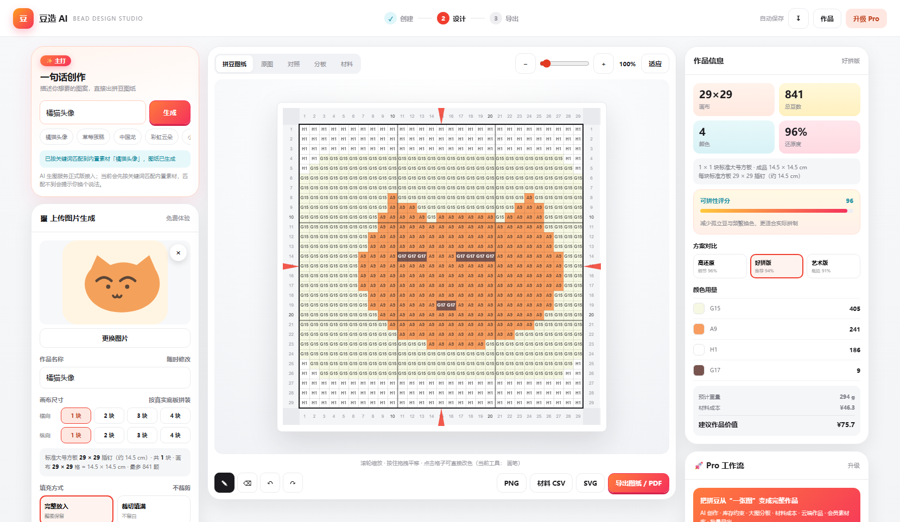
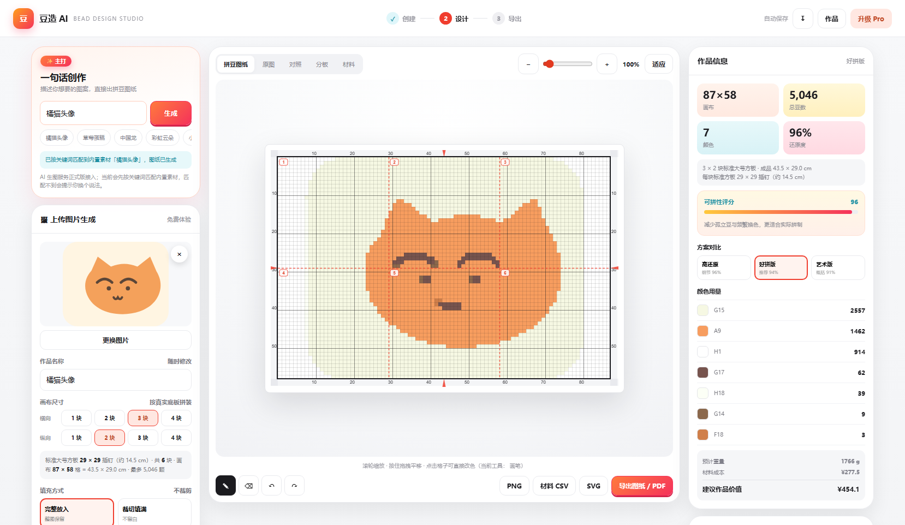
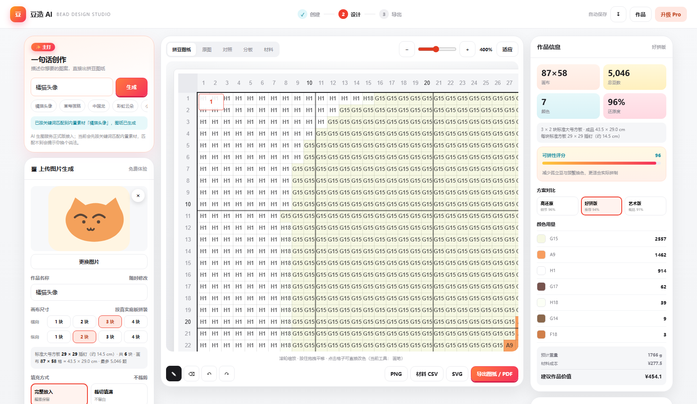
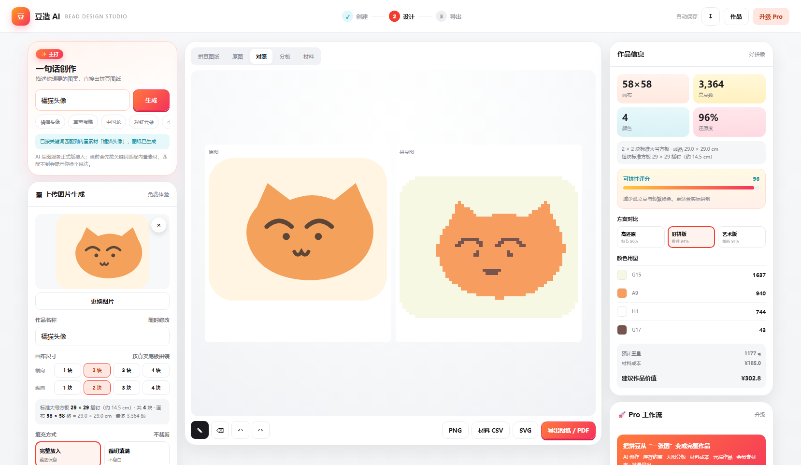
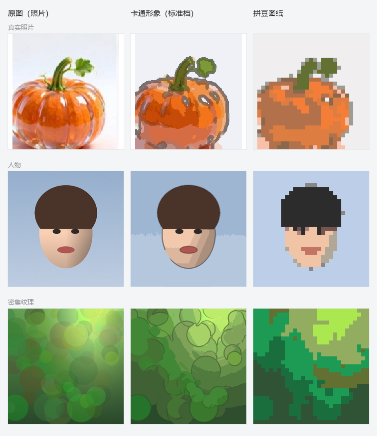

# 豆玩 DOUWAN · 拼豆图纸工作台

把任意图片转换成**能直接照着摆的拼豆图纸**：1 格 = 1 颗豆，带四边标尺、每 10 格加粗线、
拼豆底板分隔虚线与板号、格内完整色号，以及按色号统计的用量与补购清单。

画布尺寸按**市面上真实在售的拼豆底板**拼装（52 / 78 / 104 / 120 钉画线板，一钉 = 一格，实测外框 14 / 21 / 28 / 34 cm，
**整张画布只用一种规格**，尺寸 = 规格 × 块数），豆径分 2.6mm 小豆与 5mm 中号豆两套
（成品厘米 = 格数 × 豆径）；用的色板也全部是
线下可购买的真实品牌色卡，色号可直接拿去下单。

预览（下面两张图是**旧规格** 29 格板时代生成的示例，新口径的预览图待重出）：

| 1 块板（旧规格 29 × 29） | 3 × 2 块板（旧规格 87 × 58，含板号） |
| --- | --- |
|  |  |

| 放大 400% 看色号 | 对照视图 |
| --- | --- |
|  |  |

---

## 技术栈

- Vue 3.5（`<script setup>`）+ Vite 6 + `vue-router` 4（**hash 模式**）
- 纯前端 SPA，**没有后端、没有账号体系、图片不出浏览器**
- Canvas 2D 绘制图纸，按 DPR 适配高清屏
- 状态用模块级 `reactive` / `ref` 单例管理（未引入 Pinia，与项目既有约定一致）
- 样式集中在 `src/styles/global.css`，全部走设计令牌

用 hash 路由（`createWebHashHistory`）是为了让 `base: './'` + 纯静态托管（nginx / 任意子目录）
都能直接跑，不依赖服务端 rewrite。

## 快速开始

```bash
# 需要 Node 18+
pnpm install          # pnpm 11 若报 link 相关错误，用 pnpm install --node-linker=hoisted
pnpm dev              # 开发预览
pnpm build            # 构建到 dist/
pnpm preview          # 本地预览构建产物
```

> 本项目在 Windows + pnpm 11 + Node 24 环境下验证过。

## 路由一览

| 路径 | 页面 | 说明 |
| --- | --- | --- |
| `/` | 首页 | 现场生成的示例图纸、三条入口、热门素材、方案对选说明 |
| `/create` | （已并入工作台） | 只是 `/editor` 的跳转别名，保留老链接；三个入口现在就在工作台左栏里 |
| `/editor/:projectId?` | 工作台 | 唯一的工作页面。左栏「① 创建」= 上传照片 / AI 文字创作 / 免费素材库 三个入口（`?tab=ai` 可直接指到某个入口），中间是图纸编辑与导出，右栏是分析与材料；不带 id 进来就是一件还没存档的新作品 |
| `/library` `/library/:slug` | 素材中心 / 素材详情 | 分类、筛选、收藏、免费与会员分层 |
| `/projects` `/projects/:id` | 我的作品 / 作品详情 | 存档列表与单个作品的完整数据 |
| `/materials/:projectId?` | 材料与分板 | 自动分板、每板用量、缺色与补购、1:1 打印 |
| `/build/:projectId?` | 拼制与完成（第三步「完成」） | 看图纸、逐颗 / 整板记录进度（Pro）、「我拼完了 · 完成作品」：记完成时间、按材料表扣减库存（可撤销）、上传成品照片、完成分享卡 |
| `/inventory` | 我的库存 | 已有色号与数量、品牌分布、CSV 批量导入 |
| `/account` | 我的账户 | 账号与登录方式、使用统计、作品与库存概览 |
| `/settings` | 设置 | 默认参数、自定义色板、本机数据与隐私 |
| `/help` | 帮助与教程 | 上手指南、尺寸对照表、快捷键、常见问题 |
| `/tools/:slug` | 拼豆工具（SEO） | 6 个长尾落地页，每页都带可交互的真实演示 |

## 目录结构

```
src/
  main.js                    入口 + window.__douzao 调试桥（只在开发排查时用）
  App.vue                    外壳：顶栏 / 路由出口 / 页脚 / 移动端标签栏 / Toast
  router/index.js            hash 路由表 + 统一的 document.title
  lib/
    color.js                 sRGB ↔ CIELAB、CIEDE2000、亮度、对比色
    palettes.js              品牌与色号分离的注册表（4 套真实色板 + 自定义色板）
    pattern.js               核心引擎：采样 → 量化 → 映射 → 后处理 → 评分 → 导出数据
    matte.js                 自动抠背景：背景色模型 → 洪水填充 → 三区软抠图 → 连通域清洁
    cartoon.js               照片 → 卡通形象：保边平滑 → 非极大值抑制描边 → 分块平涂 → 特征回贴
    render.js                图纸 / 像素 / 分板三种画法（标尺、底板线、色号、板号、空格）
    exporters.js             PNG / SVG / CSV / JSON / 打印 / 分享卡 / 对照图
    forge.js                 展示层格式化（难度、星级、百分比、相对时间…）
  composables/
    useStudio.js             工作台状态中枢（参数 / 方案 / 编辑 / 撤销 / 存档 / 拼制进度）
    useMembership.js         套餐与权益（entitlement）判定
    useInventory.js          本机库存与缺色 / 补购计算
    useAssets.js             素材库、收藏、分类与筛选
    usePrompt.js             一句话创作（关键词匹配，非文生图）
    usePatternCanvas.js      把图案画到 canvas 的通用 hook
    useToast.js              轻量提示
  components/
    layout/                  AppHeader / AppFooter / MobileTabbar
    ui/                      BaseDialog / PatternPreview / AssetCard / ToastHost
    editor/                  EditorCanvas / EditorSidebar / EditorInsights
  views/                     14 个页面 + 404
  data/
    palette.js               真实品牌色板数据（脚本生成，勿手改）
    assets.js                51 个原创 SVG 素材（脚本生成，勿手改）
    tools.js                 SEO 工具页文案
  styles/global.css          设计令牌 + 全部组件样式
scripts/
  build-palette.cjs          色板抓取 / 交叉验证 / 生成 src/data/palette.js
  build-assets.cjs           生成 src/data/assets.js（尺寸 / 颜色数 / 难度 / 豆数由统一规则推导）
  audit.cjs                  无头浏览器自检（51 个页面 × 3 种视口）
  audit-fixture.js           自检用的示例作品：走真实生成链路写入本机存档（含自动抠背景）
  audit-matte.js             自检探针：在真实浏览器里驱动抠背景全链路并打印真实数字
  audit-cartoon.js           自检探针：驱动「照片 → 卡通形象 → 拼豆图」全链路并打印真实数字
  audit-mobile.js            自检探针：手机上工作台的版面（重排 + 折叠 + 浮动缩略图 + 选项组下拉 + 「编辑」下拉默认收起）
  audit-edit-menu.js         自检探针：手机画布右上角的「编辑」下拉（工具条收起 / 画布长高 / 点画布只关面板不落笔）
  audit-scale.js             自检探针：画布档位（52 / 104 / 312 / 自定义 936，取自 7 档阶梯）的生成耗时、单格重绘、画布像素、存档体积
  audit-size-live.js         自检探针：自定义尺寸的实时预览（改规格 / 块数不点按钮，画布与图案自动跟上；含免费版锁档、套餐收敛、成品尺寸自动计算）
  audit-photo.js             自检探针：上传照片这条路（透明贴纸自动留空+裁主体 / 画布与色号自动匹配到 7 档阶梯（最高 312）/ 长边档按同规格块数重排 / 色号上限 291 / 抠图掩膜跟源图）
  verify-archive.mjs         存档紧凑编码的往返 / 兼容 / 体积（不需要浏览器）
  verify/source-alpha.mjs    透明通道：透明背景必须是空格而不是白豆、半透明边缘不许掺白（合成图 + 几何真值 IoU）
  verify/render-*.mjs        渲染层：按色批量绘制与逐格绘制等价、脏矩形只刷改动格且源矩形单位正确、画布像素预算与缩放上限、SFC 编译
  verify/estimate-svg.mjs    SVG 体积估算闸门是否真的是「不小于实际」的保守上界
  verify/export-plan.mjs     导出规格断言：PNG 尺寸计划、PDF 页数阶梯、SVG 丢色号决策
  verify/export-plan-1000.mjs 1000×1000（100 万格）下的导出行为：PNG 降档、SVG 拒绝、分板 PDF 按 120 钉画线板出 81 页（超 256 页的门禁由 29 格老规格的 580×377 守着）、Pattern JSON 体积
  verify/pattern-fingerprint.mjs 生成引擎的指纹回归：同一批参数下 cells 与各项统计逐位/逐字对照基线
  verify/perf-1000.mjs       100 万格的生成耗时与内存（不需要浏览器）
  verify/export-smoke.mjs    导出冒烟（DOM 桩）：各入口不抛、文案带真实数字、打印文档结构
  serve-dist.mjs             本地预览 dist/（no-store，专门用来排除浏览器缓存干扰）
  fidelity/fixtures-gen.py   生成还原度评测图（真实照片 + 合成题材）
  fidelity/bench.mjs         还原度跑分：dEcell / dEview / 边缘相关，不需要浏览器
  fidelity/bench-scale.mjs   画布尺寸 × 还原度：同一张图在 29…1000 格（旧规格档位）下的色差与耗时
  fidelity/bench-colors.mjs  色号数 × 还原度：显式指定 cap（旧上限 90 是它的结论基准）扫出边际收益曲线，
  fidelity/make-scale-compare.py  把不同画布尺寸的图纸拼成 docs/canvas-fidelity-compare.png
  fidelity/fixtures-gen-cut.py   生成 6 张带真值掩膜的抠图评测图
  fidelity/matte-bench.mjs   抠图精度跑分：IoU / 每格判定一致率 / 裁切框误差
  fidelity/cartoon-bench.mjs 卡通化跑分：结构一致度 / 色相偏移 / 特征保留（不需要浏览器）
  fidelity/cartoon-sweep.mjs 卡通化单参数扫描：把某个参数扫一遍，看指标往哪个方向走
  fidelity/cartoon-sheet.py  把「原图 / 卡通 / 拼豆图」拼成 docs 里的对照图（Pillow）
  fidelity/matte-pattern-compare.mjs  「关掉 / 打开自动抠背景」的拼豆图对照图
  fidelity/png.mjs           两个评测脚本共用的极简 PNG 读写
  README.md                  色板来源与验证结论
docs/                        预览图
deploy.ps1                   一键构建并部署到服务器（nginx）
```

## 核心引擎

`src/lib/pattern.js` 是唯一的算法实现，页面只消费它的结果。
**取样与生成核心都是纯函数**（不碰 DOM），所以能在 Node 里跑回归评测 —— 见 `scripts/fidelity/`。

**取样** — 浏览器只负责把图读成 RGBA 像素（逐级减半到 ≤2048，避免一次性大幅缩小出摩尔纹；
减半过程中**不铺白底**，否则透明通道在第一步就没了，见下文「源图自带透明背景」），
真正的缩放由 `resampleRGBA()` 做「目标像素 = 对应源区域面积平均」：结果与浏览器平滑缩放同口径，
但确定性、跨浏览器一致、可离线测试。每格再取 `SS×SS` 个源像素做**多数投票**，
让边缘直接落在两种真实颜色之一，而不是取平均混出原图没有的过渡色（视觉上是「晕染」）；
票数不集中（渐变 / 噪点）时退回面积平均。

**量化** — 从色板里挑 k 个色号，用的是 **k-medoids**：候选色从头到尾都必须是色板里真实存在的色号。
① 贪心选址：每轮加入「让总映射误差下降最多」的色号；② Lloyd 迭代：像素归到最近色号 →
每个簇重新挑簇内误差最小的色号，直到稳定。全程确定性（不用随机数）。
比原来的「k-means 出自由质心 → 质心找最近色号」更准：后者经常两个簇抢同一个色号，
抢不到的那个只能退而求其次。

**映射** — 每格用 **CIEDE2000** 找最近色号（先用 Lab 距离筛出 3 个候选，再在候选里算 ΔE00，
兼顾精度与速度）。色号之间往往只差一档明度，Lab 欧氏距离在这个尺度上会系统性偏向高彩度色。
抖动默认关闭（PRD §15.3）。开启后是有意识的误差扩散，还原度按「无抖动量化图」计算，
不把有意的噪点算成失真。

**后处理** — 合并零星色（换色次数↓）、去孤立豆（四邻无同色就改成邻居里出现最多的颜色），
两者都带**感知护栏**：只有当色差小到肉眼几乎看不出（合并 ΔE00 ≤ 6 / 去孤立豆 ≤ 18）才动，
否则宁可多留一个色号 —— 一颗眼睛、一道轮廓线正是「只用 1~2 颗但很关键」的颜色，
按用量一刀切会把它们并掉。

**评分** — 全部由真实网格数据算出，没有写死的数字：

- 还原度 = 与**邻域平均色**的平均 CIEDE2000。用邻域平均是刻意的：拼豆是颗粒介质，
  单格取色必然有偏差，人眼在正常观看距离看到的是邻域平均色。
  开抖动时按**无抖动量化图**算（`mapCells` 返回的 `adjacent`）——
  否则分数会从 94% 掉到 21%，而人眼看到的其实更接近原图，那是指标算错了对象。
- 可拼性 = `0.25×孤立豆 + 0.20×换色 + 0.20×色块连贯 + 0.20×轮廓 + 0.15×颜色数`
- 预计时间 = `豆数 / (17 + 可拼性/100 × 12)`

**三方案**（`variantParams`）真正差异化，不是换个名字：

| 方案 | 色数上限 | 后处理 | 定位 |
| --- | --- | --- | --- |
| 高还原 | `目标 + 4` | 不清理 | 细节优先、色号最多 |
| 好拼版 | `目标 × 0.62` | 合并零星色 + 去孤立豆 | 换色少、最快拼完 |
| 艺术版 | `目标 × 0.42` | 色阶概括 + 合并 + 去孤立豆 | 色块分明、风格化 |

推荐方案不是简单取还原度最高，而是找**「还原度够高 + 可拼性明显更好 + 豆数合理」的 Pareto 点**。

### 抠图：去背景 + 去投影，只留主体（`src/lib/matte.js`）

在**「① 创建」卡片里、上传图片正下方**打开「抠图去背景」（这一行小控件就是开关，
打开后右侧长出保守 / 标准 / 激进三档）。打开后背景位置**不放豆**（`cells` 里的 `-1` = 空格），
并自动裁到主体范围，让主体占满整块画布 —— 同一张 52 × 52（一块 52 钉板）的画布，格子全用在主体上，还原度自然更高。

要的结果是**只剩一个干净的物体**：没有背景，也没有拍照时落在地上/墙上的影子。

算法全部是经典图像处理，没有模型、没有网络、**确定性可复现**（同一张图每次结果一致）：

1. **外圈背景色模型** — 取图像外圈像素（等距抽样到 ~1500 个）在 Lab 空间做 k-means，
   最多 3 个簇，簇内离散度会进入容差（噪点背景自动放宽）。
   外圈天然几乎全是背景，同时能容纳「白边 + 卡片底色」这种双色背景。
2. **从四边向内洪水填充** — 只走「像背景」的像素，且**不允许跨过强边缘**（ΔE00 > edgeLimit）。
   这是「白衬衫上的白色、雪人身上的白色不被一起吃掉」的关键：它们与背景只是颜色像，并不连通。
3. **阴影清除**（见下）— 投影既不是主体、也不是背景色，只靠第 2 步的容差会在物体周围留下一圈灰豆。
4. **三区软抠图** — 确定背景 / 未知带 / 确定前景。未知带（边界 ±1~3px）里用**颜色线投影**
   估 α：`α = clamp(dot(I-B, F-B)/|F-B|²)`，F、B 取最近的确切前景/背景像素颜色。
   发丝、绒毛、抗锯齿边缘因此得到真实的 0~1 覆盖率，而不是硬阶梯。
   确定/未知的划分必须用**区域内部深度场**——用「到背景区的距离」会让确定背景恒为空集，
   软抠图被整体跳过、边缘硬化外扩（这是实现过程中真实踩过并修掉的 bug）。
5. **连通域清洁** — 去掉主体上的小碎点、补掉主体内部的小孔（高光点），
   以及「与主体不连通、且多数像素离背景色模型够近」的游离块（背景色稍有偏移就会漏判出几块）。
6. **稳健包围盒** — 裁切框只按「主体 + 占比 ≥4% 的独立部件」算，不被主体边缘在杂背景里
   拖出的细须撑大（实测过：细须会把框撑出上百像素，主体因此只占画布一半）。

#### 阴影（投影）为什么能被单独判出来

投影的成因是「直射光被挡住、只剩环境光」，在**线性光空间里就是逐通道乘法**：
`p_lin ≈ k · bg_lin`（k = 光照保留比例；环境光偏冷，所以 k_B 通常略大）。由此得到两个性质：

- **颜色** — k 的三个分量彼此接近（同一种材质、只是被压暗）。彩色主体压在浅底上的抗锯齿像素
  是「两个颜色的混合」，k 三分量会散得很开，直接被排除（`shadowSpread`）。
- **边缘** — 阴影的 k 是**渐变**的，而物体轮廓是**硬边**。这条是分辨「浅灰物体」与「灰阴影」的
  唯一可靠信号：一块中灰物体放在白底上，颜色上与阴影毫无区别（都只是"白乘一个系数"），
  只有"轮廓一步跨过去 vs 阴影连续衰减"能分开（`shadowStep`，标准档 0.10）。

洪水填充因此要求相邻像素的 k 变化不超过 `shadowStep`，硬边一律不许跨；生长方向只能是
「从已确认的背景/阴影往外扩」。另外记了一层**安全网**：如果阴影那一步吃掉了原本前景的绝大部分
（剩余 < 原前景的 5% 且 < 全图 1.2%），就整体回滚、保留阴影 —— 去掉阴影是体验优化，
把主体删掉是事故，两者不能等价权衡。

> 已知边界：如果某个阴影的边界和物体轮廓一样锐利，它在颜色与几何上都与"深色物体"不可区分，
> 这时算法会保守地保留它；「激进」档可以再试。

**映射到格子**（`resampleRGBA` 的 `mask` / `cover` 参数）：每格统计 `SS×SS` 个源像素的主体覆盖率，
覆盖率 < 阈值（保守 0.40 / 标准 0.52 / 激进 0.62）判为空格；**格子取色只用主体像素**，
不与背景做平均 —— 否则轮廓一圈会混出原图没有的浅色，也就是白边。
空格不参与选色（否则白背景会白白占掉一个色号）、不进材料表、不计入豆数。

阴影并入背景后按**确定背景**处理，不会落进未知带被颜色线分到半个 α —— 那样边缘还是会留一圈灰豆。

置信度不足时**不硬抠**：返回 `ok:false` + 原因（例如纯色图「背景占比过高」），
上层保留整图并在侧栏如实说明，而不是把主体整个吃掉。抠图不完美的地方，
用画布上的**橡皮擦**（擦成空格）手动补即可 —— 橡皮的语义就是"这一格不放豆"。

抠图精度（9 张带真值掩膜的合成图，`npm run fidelity:matte`）：

| 档位 | 平均 IoU | 逐像素一致 | 每格判定一致率 | 大画布一致率（300 格，旧口径） | 裁切框误差 | 适用 |
| --- | --- | --- | --- | --- | --- | --- |
| 保守 | 0.916 | 0.984 | 0.985 | 0.984 | 14.2px | 白底 / 纯色底，只去柔和的影子 |
| **标准** | **0.998** | **1.000** | **0.999** | **0.999** | **0.4px** | 默认，通用 |
| 激进 | 0.915 | 0.915 | 0.913 | 0.915 | 0.3px | 杂乱背景（容易误伤浅色物体） |

掩膜边长按源图走（`matteMaxSide`，9 张图平均 517、上限 1024；旧口径是固定 384）：

| 标准档 | 掩膜 384（旧） | 掩膜跟源图（现在） |
| --- | --- | --- |
| 平均 IoU | 0.991 | **0.998** |
| 裁切框误差 | 0.7px | **0.4px** |
| `cut_circle_white` 预测边界像素 / 真值 | 2300 / 2260（+1.8% 毛刺） | **2260 / 2260** |
| `cut_white_on_white` 同上 | 1868 / 1826（+2.3%） | **1826 / 1826** |
| 每格覆盖率平均误差（300 格口径） | 0.0017 | **0.0005** |
| 1200×900 单次耗时 | 46ms | 227ms |

边界像素数比真值多出来的那一截，就是肉眼看到的毛刺；现在这几张图**逐像素等于真值周长**。
代价写在「已知限制」里（耗时 113 → 165ms，以及"几乎全是背景"的图更容易落进兜底）。

其中两张**专测投影**的图（`cut_shadow_soft` 柔和接地影 + 侧向投影、`cut_shadow_hard` 边界更利的投影），
把「阴影清除」这一步单独关掉再跑同一批图，可以直接看出它贡献了多少：

| 用例（标准档） | 关掉阴影清除 | 打开阴影清除 |
| --- | --- | --- |
| `cut_shadow_soft` IoU / 每格 IoU / 裁切框 | 0.905 / 0.936 / 8.0px | **1.000 / 1.000 / 0** |
| `cut_shadow_hard` IoU / 每格 IoU / 裁切框 | 0.570 / 0.574 / 72.8px | **0.997 / 1.000 / 0.25px** |

```bash
node scripts/fidelity/matte-bench.mjs --level normal --label cut-normal              # 打开阴影清除
node scripts/fidelity/matte-bench.mjs --level normal --label cut-base --no-shadow    # 关掉它做对照
```

还有一张 `cut_gray_on_white`（白底 + 无描边中灰物体）专门守「别把浅色物体当阴影吃掉」：
标准档下 IoU 0.9999，阴影清除开关对它没有影响。

单张「白底 + 纯白主体 + 黑描边」的雪人：IoU 1.000、每格一致率 0.995、裁切误差 0px ——
「颜色像背景但被描边隔开的主体不能被吃掉」这条守住了。
耗时：分析在 ≤1024 边长上做（跟着源图，见 `matteMaxSide`），一张 1200×900 约 227ms；
三方案共用同一次抠图（不是在每个方案里各抠一遍）。

### 照片 → 卡通形象 → 拼豆图（`src/lib/cartoon.js`）

写实照片直接转图纸，皮肤、毛发、树叶这些细纹理会被一格一格地"翻译"成杂色豆子 ——
颜色数不少、色块却很碎，拼起来最费劲。所以「① 创建」里给了第二条路线：
**先把照片概括成简单卡通形象，再转拼豆图**（开关就在「抠图去背景」下面一行，两者可同时开）。

缩略图上有「原图 / 卡通」两个小按钮，出图之前就能当场对照。



（三行分别是真实照片、人物、密集纹理；左列原图，中列标准档卡通形象，右列最终拼豆图纸）

**第一原则：只许概括，不许编造。** 这一条是硬约束，不是宣传语：

- **平涂色 = 该色块内原图像素的平均值**。先按颜色分区，再按"空间上连不连"把每个标签切成
  互不相连的色块，每块用**自己的原图真实像素**求均值 —— 所以输出的每一种颜色都是原图自己的
  颜色。切块这一步是必需的：同一个颜色标签在画面上常有好几处（左右两只靴子、两段裙子条纹），
  整体取均值会把远隔两端的深蓝和浅蓝平均成一个**原图上不存在的中间蓝**；
- **描边色 = 该像素在平滑图上的局部颜色按比例压暗**（sRGB 三通道同乘一个系数 = HSV 里色相不变、
  只降明度），再按明度收力：深色头发 / 黑靴子上的线几乎不动（那里本来就该是深色），
  亮橙色的南瓜、白色高光边上的墨色会收掉大半。线条的颜色来自它所在区域的颜色，不是硬压一层黑；
- **特征回贴 = 小尺度上对比最强的那些位置，直接保留原像素颜色**（眼睛、鼻孔、文字、高光）。
  卡通化最容易抹掉的正是这些只有几个像素、却决定像不像的部位；
- 全程**没有模型、没有网络、没有随机数**：经典图像处理，同一张图每次结果完全一致。

算法（每一步都能单独关掉做对照）：

1. **降到工作分辨率**（≤768 边长，面积平均）。为什么不是 512：512 "够用"是拿**色块**算的，
   没算**五官** —— 全身照里眼睛只有画面的 1.5% 宽，512 下不到 8 个像素，描边一加粗就没了；
2. **保边平滑**（可分离双边滤波，颜色权重只看亮度差）：抹掉细纹理，同时不跨过真实边缘 ——
   跨过去就糊成一团，特征当场丢失；
3. **轮廓线**：平滑后的亮度做 Sobel → **非极大值抑制**（沿梯度方向细化成 1px 线）→
   **双阈值滞后**（连成闭合曲线）→ 按半径铺成有宽度的实心线。
   阈值取骨架分布的 0.99 分位（自适应：暗调 / 低对比照片同样适用），所以只在原图真有边缘的
   地方落线；**高光不算轮廓** —— 玻璃、塑料的反光在原图里是亮的，只用梯度判断会给每个反光点
   套一个黑圈，所以额外做了一个高光遮罩，那里不落墨、线也不许穿过去；
4. **平涂分区**：在 Lab 空间对图像自身的颜色做加权 k-means（5bit 桶直方图加速、最远点初始化，
   全程确定性）；
5. **色块切块**：同标签但不相连的色块各自取色；比 `minChunk` 还小的碎块并进**接触边界最长**
   的邻块并沿用邻块的颜色（不把两者的像素平均 —— 深色印花混进黄衣服的均值会得到灰绿色，
   那是原图上任何一处都不存在的颜色）。相邻且几乎同色的两块最后再并一次色号；
6. **特征回贴**：细节强度按**三通道最大差**（不是只看亮度）算 —— 东亚人的瞳孔与周围皮肤的
   **亮度**常常只差 1 个灰度级，只看亮度会把眼睛判成"没细节"而整块平涂掉，脸就平了；
   先做 3×3 平均再取分位数门限，只有成团的强细节保留原色，单像素噪点会被压下去；
7. **逐像素合成**：平涂色 → 叠描边 → 贴回特征；最后按最近邻放大回源图分辨率，
   放大过程不引入任何新的中间色。

三档风格（侧栏与设置页共用同一份预设）：

| 风格 | 定位 | 平涂色块 | 色块纯度 | 远看 ΔE | 色相偏移 | 边缘召回 | 边缘精确 | 特征保留 | 耗时 |
| --- | --- | ---: | ---: | ---: | ---: | ---: | ---: | ---: | ---: |
| 轻度 | 只去纹理，保留最多细节 | 33.0 | 0.987 | 2.32 | 1.6° | 0.693 | 0.706 | 1.140 | 110ms |
| **标准** | 通用：纹理抹平 + 清楚轮廓 | 26.0 | 0.984 | 2.66 | 1.8° | 0.558 | 0.528 | 1.000 | 153ms |
| 简约平涂 | 大色块 + 粗描边 | 11.3 | 0.968 | 3.65 | 2.1° | 0.483 | 0.414 | 0.881 | 186ms |

（7 张评测图平均，`npm run fidelity:cartoon`；512² 源图，Chrome/Node 同一份算法）

指标口径：

| 指标 | 看什么 |
| --- | --- |
| 色块纯度 | 每个平涂色块内部在原图上本来就是一致的（1 = 没有把两个不同的东西糊成一块） |
| 远看 ΔE | 卡通图 vs 原图邻域平均色的平均 CIEDE2000（概括了多少） |
| 色相偏移 | 色相角差的中位数（度）。凭空编颜色会立刻抬高它；实测 1.6–2.1° |
| 边缘召回 / 边缘精确 | 原图的轮廓有多少还在（召回）、卡通里的线有多少落在原图轮廓上（精确）；允许 1 像素位移 |
| 特征保留 | 原图最强的 2% 细节（眼睛 / 文字 / 高光）在卡通里还剩多少局部对比 |

**关于"平涂色块"这个数**：它数的是最终留下的色号数。卡通化**出图前**还会按界面上的
「颜色数」再合并一次，所以图纸上的色号数（6.6~7.0）远少于这个数 —— 这里留细一点更划算，
反正下一步会合并，留粗了细节就再也回不来了。

```bash
npm run fidelity:cartoon                    # 跑分（结构 / 色相 / 特征保留 + 对图纸的影响）
node scripts/fidelity/cartoon-bench.mjs --style flat --render   # 只看平涂档，并把对照图渲染出来
node scripts/fidelity/cartoon-sweep.mjs --param inkWidth --values 0,1,2,3   # 单参数扫描，看指标往哪走
python scripts/fidelity/cartoon-sheet.py    # 拼出 docs/cartoon-before-after.png（需先 --render）
npm run verify:cartoon                      # 真实浏览器里驱动全链路（含 DOM 点击与真实数字）
```

同一个 batch 里还会回答"对图纸到底有没有帮助"：卡通化之后的源图再走同一条拼豆链路，
色号数 7.4 → 6.7、可拼性 0.74 → 0.74、孤立豆 6 → 8，而**色块明显变大**
（评测图渲染在 `scripts/fidelity/out/renders/cartoon/`，肉眼可以直接比）。

**它做不到什么**（如实写在这里）：

- **不是生成模型**，所以不会"补画"眼睛、花纹、背景 —— 原图糊、脸小、遮挡严重时，
  出来的卡通形象也一样糊。手绘插画那种"头大身小"的比例是画师的再创作，这里不会做；
- **做不到"比原图更平"**。原图本来就是平涂卡通（比如一张现成的插画）时，卡通化的意义
  只在换配色与合并色块；这时候描边会让"无边缘处的压平度"这个指标变成负数 ——
  这是加粗描边的直接代价，不是算法坏了；
- 平涂意味着相邻两个色号在大色块里会被合并成一个，需要更多层次时把「颜色数」调高或换「轻度」档。

## 还原度回归评测（scripts/fidelity/）

算法改动很容易「修好这张、弄坏那张」，界面上那个百分比又偏乐观（拿图案单格去比原图邻域平均色），
所以有一组固定的评测图和一套互相独立的指标，改动前后各跑一次看数字：

```bash
python scripts/fidelity/fixtures-gen.py      # 生成 7 张测试图（含真实照片与合成题材）
npm run fidelity                             # 图案还原度跑分
python scripts/fidelity/fixtures-gen-cut.py  # 生成 6 张带真值掩膜的抠图测试图
npm run fidelity:matte                       # 抠图精度跑分（IoU / 每格判定 / 裁切框误差）
node scripts/fidelity/matte-bench.mjs --label cut-384 --maxside 384   # 改动前的掩膜基线（384 边长）
node scripts/fidelity/matte-pattern-compare.mjs   # 抠背景前后的拼豆图对照（看图更直观）
```

指标（越小越好；`dEcell` / `dEview` 都不依赖界面上的还原度）：

| 指标 | 口径 | 看什么 |
| --- | --- | --- |
| `simApp` | 界面显示的还原度 | 只作对照 |
| `dEcell` | 每格：图案颜色 vs 该格原图像素均值 | 这一颗豆对不对（最严格） |
| `dEview` | 图案按每格铺开、与原图一起按一格半径模糊后逐像素 ΔE00 | 远看像不像 |
| `edgeCorr` | 相邻格色差的皮尔逊相关 | 会不会「越优化越糊」 |

最近一次改动（k-medoids 选色 + CIEDE2000 映射 + 感知护栏 + 放开发色号）在 7 张图上的平均：

```
                          界面还原度      每格 ΔE        远看 ΔE      边缘相关
改前（旧算法 + 48 色池）     92.3%         6.49          5.54         0.721
改后（新算法 + 48 色池）     92.6%         6.17 (-5%)    5.27 (-5%)   0.745
改后（新算法 + 漫德全色号）   94.2%         4.61 (-29%)   3.88 (-30%)  0.786
```

顺带修掉一个真实 bug：`mapCells` 的抖动分支既没返回 `adjacent`，又把参考图 `quantRgb`
留在全黑状态 —— 表现是「一开抖动，界面还原度从 94% 掉到 20%」，
而实际画面只是按预期变得有颗粒感。现在开抖动时还原度按无抖动量化图算（94%），
同时「远看 ΔE」从 3.88 降到 3.52（确实更接近原图的过渡），代价是孤立豆从 6 颗涨到 28 颗。

## 画布尺寸口径：52 / 78 / 104 / 120 钉画线板 + 两套豆径

口径的唯一真源是 `src/lib/boardSpec.js` —— 它同时管「板 / 格 / 豆径」三件事，
`pattern.js` 的 `patternProfile()` / `boardLayout()`、`exporters.js` 的 `boardOf()` / `cmPerBeadOf()`、
`MaterialsView.vue` 的 `printPaper` 都从它取值，改一处全站跟着变。
一句话结论：**拼板是 52 / 78 / 104 / 120 钉四个规格（「钉」= 一条边上的钉位数，一钉 = 一格，实测外框 14 / 21 / 28 / 34 cm），
整张画布只用一种规格，尺寸 = 该规格 × 块数；豆径有两套，跟着分板规格走。**

### 四个规格，一钉 = 一格

| 规格（一块板） | 单板格数 | 成品厘米（2.6mm 小豆） | 定位 |
| --- | ---: | ---: | --- |
| 52 钉画线板 | 52 × 52 = 2,704 | 13.5 × 13.5 cm | 钥匙扣 / 杯垫，免费版上限 |
| 78 钉画线板 | 78 × 78 = 6,084 | 20.3 × 20.3 cm | 桌面小摆件 |
| 104 钉画线板 | 104 × 104 = 10,816 | 27.0 × 27.0 cm | 五官与衣纹开始出来 |

单板都是正方形（52×52 / 78×78 / 104×104 格），板与板之间卡扣并排拼。
比一块板更大的画布 = **同规格再拼几块**：2 × 3 块 52 板就是 104 × 156 格，
4 × 4 块 78 板就是 312 × 312 格。所以画布尺寸永远是「某一个规格」的整数倍。

### 为什么禁止混规格

三块板都是同一颗 2.6mm 豆的板、钉距相同，所以「并排摆着拼、让图案跨过接缝」是可以的；
但要把一个矩形**铺满**，每个方向都必须是同一规格的整数倍 —— 三者的最小公约数是 26，
而市面上没有 26 钉的板：78 宽 = 52 + 26，那 26 格没有任何一块板能补齐。
混规格（52 宽 + 78 宽，或者 78 × 104 这种矩形）最外圈必然空一条，甚至得再买一块大板去盖。

早期版本会给出「78 × 104 = 1 块 78 板 + 1 块 104 板」这种并不存在的板；现在
`normalizeBoardSize()` 见到两个方向规格不一致的 `boardSize` 一律收敛成按画布推导的**单一规格**，
`boardSpecFor()` 也只会返回 52 / 78 / 104 / 120（或老规格 29）里的一个。

### 七档阶梯：每档只定长边，规格与块数看图片方向

`SIZE_TIERS` 有 7 档，每档只定**长边多少格**与「适合做什么」：

| 档位（长边格数） | 名称 | 说明 |
| ---: | --- | --- |
| 52 | 入门 | 一块 52 钉板 · 钥匙扣 / 杯垫 |
| 78 | 标准 | 一块 78 钉板 · 桌面小摆件 |
| 104 | 精细 | 一块 104 钉画线板（28 × 28 cm） · 五官、衣纹开始清楚 |
| 120 | 高精细 | 一块 120 钉画线板（34 × 34 cm） · 照片能认人、宠物照 |
| 156 | 超精细 | 2 × 2 块 78 钉画线板（42 × 42 cm） · 挂画级 |
| 208 | 超大 | 2 × 2 块 104 钉画线板（56 × 56 cm） · 大挂画、多人合影 |
| 312 | 极限 | 3 × 3 块 104 钉画线板（84 × 84 cm） · 先转准，再导 PNG 存档 |

用哪个规格、拼几块，由 `tierBox(tier, aspect)` 按**图片方向**挑：在「能整除长边的规格」里选，
使块数比（短边块数 / 长边块数）最接近图片比例，并列取大规格（板少、板大更好拼）。
于是同一个 312 档：正方图是 3 × 3 块 104 板（312×312），3:4 竖图是 3 × 4 块 78 板（234×312）、
1:2 竖图是 2 × 4 块 78 板（156×312，也可写成 3 × 6 块 52）。

| 档位 | 正方形 | 3:4 竖图 | 2:3 竖图 | 1:2 竖图 | 4:3 横图 | 3.2:1 横图 |
| ---: | --- | --- | --- | --- | --- | --- |
| 52 | 52×52（1 块 52） | 52×52 | 52×52 | 52×52 | 52×52 | 52×52 |
| 78 | 78×78（1 块 78） | 78×78 | 78×78 | 78×78 | 78×78 | 78×78 |
| 104 | 104×104（1 块 104） | 104×104 | 52×104（2 块 52） | 52×104（2 块 52） | 104×104 | 104×52（2 块 52） |
| 120 | 120×120（1 块 120） | 120×120 | 120×120 | 120×120 | 120×120 | 120×120 |
| 156 | 156×156（2×2 块 78） | 104×156（2×3 块 52） | 104×156（2×3 块 52） | 78×156（2 块 78） | 156×104（3×2 块 52） | 156×52（3 块 52） |
| 208 | 208×208（2×2 块 104） | 156×208（3×4 块 52） | 156×208（3×4 块 52） | 104×208（2 块 104） | 208×156（4×3 块 52） | 208×52（4 块 52） |
| 312 | 312×312（3×3 块 104） | 234×312（3×4 块 78） | 208×312（2×3 块 104） | 156×312（2×4 块 78） | 312×234（4×3 块 78） | 312×104（3 块 104） |

（表里的数字是 `tierBox` 的返回值，可用 `node` 直接跑 `boardSpec.js` 复核 —— 每一格的两个方向
都是同一个规格的整数倍，没有「78 × 104」这种矩形。）

一块板的四个档位（52 / 78 / 104 / 120）没有可调的余地，只能是正方 —— 那是实物的物理边界
（120 只有一个因数，所以它在任何图片方向下都是 120 × 120；窄长图靠 156 档重排成 3 块 52 才贴合）。
更大的档位是「把这张图转多细」，按比例重排的理由见下文；**312 是上限**：
再往上（4 × 4 块 104 = 416 格 ≈ 17.3 万格）已经是「先把图转准」的量级 —— 成品约 1.08 m 见方、
几万颗豆，照着拼不现实，这一档的用法是导出 PNG 存档。真要更大，走「自定义尺寸」按规格一块一块加。

改尺寸会**立刻重新生成**图案。图案自己的宽高是生成那一刻定下来的，只改选项不重算的话，
界面会写着「画布 104 × 156 格」而画布上还是旧的 52 × 52 图案 —— 看起来就像按钮没反应。
图纸上的红色虚线刚好落在**真实的板边**上（按图纸自带的单一规格，每 52 / 78 / 104 / 120 格一条），
角标数字是板号；尺寸摘要实时显示成品物理尺寸（格数 × 豆径）与最大豆数。

### 自定义尺寸：规格 × 横向几块 × 纵向几块

`customBox({spec, cols, rows, max})`：规格只能取 52 / 78 / 104 / 120，长宽必然是同一规格的整数倍。
面板下面直接算出成品尺寸（格数 × 豆径）与板面外框，改规格 / 块数就跟着变。
Pro 单边上限 1000 格，于是每个规格能加的块数上限是：

| 规格 | 单边最多几块 | 最大画布 | 格数 |
| ---: | ---: | --- | ---: |
| 52 钉板 | 19 块 | 988 × 988 | 97.6 万 |
| 78 钉板 | 12 块 | 936 × 936 | 87.6 万 |
| 104 钉板 | 9 块 | 936 × 936 | 87.6 万 |
| 120 钉板 | 8 块 | 960 × 960 | 92.2 万 |

超出上限时自动收敛到能装下的最大块数，并在界面上说明「被收敛了」（不静默改小）。

### 两套豆径：52 / 78 / 104 / 120 钉画线板配 2.6mm 小豆（默认），29 格老规格配 5mm 中号豆

| 豆径 | 配什么板 | 1 格 | 成品厘米 | 单颗克重 |
| --- | --- | ---: | --- | ---: |
| **2.6mm 小豆**（默认） | 52 / 78 / 104 / 120 钉画线板 | 2.6 mm | 52 格 ≈ 13.5 cm、104 格 ≈ 27.0 cm、120 格 ≈ 31.2 cm | 0.01 g |
| 5mm 中号豆 | 29 格大号方板（老规格） | 5 mm | 29 格 ≈ 14.5 cm、58 格 ≈ 29.0 cm | 0.07 g |

**成品厘米 = 格数 × 豆径**，没有第二个口径（`cmPerBead` 直接乘）。设置页里可以手动切换豆径
（`options.beadKey`，留空 = 自动），自动档由 `autoBeadKey(w, h)` **按分板规格**判断：
退到 29 格老规格 → 5mm 中号豆，其余（52 / 78 / 104 / 120 钉画线板）→ 2.6mm 小豆。

为什么不按「画布是不是整板」判断：豆径是拼板的物理属性。老长边档位 1000 格会退到 120 钉画线板分板，
若还按 5mm 算，一块 104 钉板会被算成 52 cm 宽 —— 自相矛盾。这条踩过一次，
所以判断依据钉死在分板规格上（`autoBeadKey` 只看 `boardSpecFor()` 的结果）。

图纸上的口径在**生成那一刻**定下来（`patternProfile()` 把 `beadKey` / `beadMm` / `cmPerBead` /
`beadWeightG` 写进 pattern），之后用户改设置不会让已经存好的作品跟着变 —— 老存档缺这些字段时
由 `fromPatternJSON()` 补。两套豆径的换算口径见上表，
**别拿 5mm 的克重去算小豆**（塑料用量差约 7 倍）。

### 老存档照旧

`canvasW/canvasH` 是 29 的整数倍（29 / 58 / 87 / 116 / 232 / 464）时，`boardSpecFor()` 第一步就返回 29、
豆径走 5mm —— 打开旧作品与以前逐格一致，老素材（照 29 格画的 SVG）也一样。
老的长边档位 300 / 450 / 750 / 1000 也能打开，但分板退到 104 / 120 钉画线板（取板数最少的那个）、豆径按 2.6mm 小豆算
（这几个尺寸当年就是「先把图转准」用的，实物厘米本来不作数）。29 这条分支不能删：
免费素材与老存档都还指着它（见 `boardSpec.js` 文件头）。

### 会员上限

| 能力 | 免费 | Pro |
| --- | --- | --- |
| 画布单边 | 52 格（= 一块 52 钉板） | 1000 格（自定义：52×19=988、78×12=936、104×9=936、120×8=960） |

上限从权益表读（`canvas.cells`：free 52 / pro 1000），一处改全站跟着变；免费版超上限时
**夹回 52** 而不是拒绝生成。

### 分板 / 材料清单 / 成品厘米 / 1:1 打印

这四件事都读**图纸自带**的口径：`boardSize`（单一规格）+ `beadKey` / `cmPerBead` / `beadWeightG`，
见 `pattern.js` 的 `patternProfile()` / `boardLayout()` 与 `exporters.js` 的 `boardOf()` / `cmPerBeadOf()`。
分板按 `ceil()` 切，所以铺不满时最外圈留空，材料表与逐板 PDF 会如实说明（`boardsText()` 的
「3 × 3 块 104 钉板（最外圈留空）」就是这句话）。

1:1 打印的纸幅 = 一块板的格数 × 豆径 + 两侧标尺（典型 cell 下共约 9 mm）：

| 板 | 纸面宽（1:1） | 放得进 |
| --- | ---: | --- |
| 29 格板（5mm，老规格） | 约 162 mm | A4 竖版（可打印约 190 mm） |
| 52 钉板（2.6mm） | 约 144 mm | A4 竖版 |
| 78 钉板（2.6mm） | 约 212 mm | A4 横版（可打印约 277 mm） |
| 78 钉板（2.6mm） | 约 212 mm | A4 横版（可打印约 277 mm） |
| 104 钉板（2.6mm） | 约 279 mm | A4 竖版 / 横版都放不下 → **A3 横版或按纸幅分条** |
| 120 钉画线板（2.6mm） | 约 321 mm | A3 横版（可打印约 400 mm） |

`MaterialsView.vue` 的 `printPaper` 按纸幅档提示（≤190 A4 竖版 / ≤277 A4 横版 / ≤400 A3 横版 / 更大拒绝）。
不再写「每块板单独一页就保证 1:1 可用」—— 那是 29 格 + 5mm 时代的经验（约 15.4 cm）：
104 钉板的纸面宽 279.3 mm，比 A4 横版可打印的 277 mm 还差 2 mm。

### 历史实测：为什么格数要往上加（旧规格 29 格 / 5mm 下量的）

> ⚠️ **下表是旧规格（29 格板 / 5mm 中号豆）下的实测**，换新规格后格数的含义变了：
> **52 ≈ 旧的 29、104 ≈ 旧的 116、312 ≈ 旧的 300**（三组是同一档用途：一块小板的入门 /
> 能认出五官的精细 / 照片级的极限）。表里的数字量的是「每颗豆准不准」，与豆径无关，结论照旧成立；
> 只是尺寸标签按旧规格读（新口径 312 格 = 81 cm 见方，旧 300 格 = 150 cm）。

旧规格下默认档位最多 4 × 4 块 = 116 × 116 格，这个格数对图标、宠物头像够用，但**复杂照片转不出来**：
116 格铺一张真人照，五官会被量化成几块色斑。实测（`scripts/fidelity/bench-scale.mjs`，
同一张真人照片 1337×1755、`easy` 方案、目标 30 色、源图上限 2048）：

| 画布 | 每格色差 dEcell（每颗豆准不准） | 远看色差 dEview（缩到 256² 比） | 看出来的东西 |
| --- | ---: | ---: | --- |
| 29 × 29 | 3.22 | 3.67 | 一团色块 |
| 116 × 116 | 2.37 | 1.54 | 认得出是个卡通小孩 |
| 300 × 300 | 2.07 | 1.30 | 五官、衣服褶皱都在 |
| 450 × 450 | 1.99 | 1.31 | 与 300 档远看几乎一样，但每格更准 |
| 1000 × 1000 | **1.91** | 1.29 | 每颗豆更贴近原图那一块的颜色（发丝、褶皱的一格一个色块） |

两件事必须一起读：**dEview 在 300 格就基本到顶**（旧口径；新口径的对应档是 312。它是"缩到
256×256 再比"，格数再多也不会让远看更像），而 **dEcell 一直在降** —— 所以 300 格以上买的不是
"更像"，是"每颗豆更准"。这也解释了为什么有人转了 300 格仍然觉得不够：他要的细节（一根发丝、
一道衣褶）落在"一格一个色块"的量级上，那只能靠格数。

**长边档与按比例重排。** 52 / 78 / 104 这三档是按板算的正方形（它们的意义是"正好用满一块板"，
板的格数是实物的物理边界）；156 / 208 / 312 写的是**长边格数**，另一边由 `tierBox` 在**同一规格内**
按原图比例定块数（见上文那张各方向的尺寸表）。大档如果也强行正方，一张 0.59 比例的竖图放进
旧口径的 300 × 300 就只有 177 列有内容 —— 用户点的是 300 格，拿到的却是 177 格的清晰度，
剩下 40% 的格子（和豆子）全用在留白上。按原图比例重排之后，同一档位下主体的清晰度直接 ×1.7；
按钮上写的就是算完的实际尺寸（例如 3:4 竖图的 208 档 →「156×208 长边 208」）。

**色号是另一半瓶颈。** 同一张图、同一档位、只改目标色数（`scripts/fidelity/bench-colors.mjs`
的色号收益曲线，**旧规格口径**的 116 格与 300 格两档、两张真实照片 —— 约等于新口径的 104 格与 312 格）：

| 目标色数 | dEcell（116² / 300²） | dEview | 实测用色 | 每 +10 色的边际 dEcell |
| ---: | ---: | ---: | ---: | ---: |
| 16 | 2.40 / 2.15 | 1.53 / 1.37 | 16 | — |
| 24 | 2.23 / 1.91 | 1.37 / 1.15 | 24 | +0.21 ~ +0.30 |
| 32 | 2.13 / 1.82 | 1.32 / 1.06 | 32 | +0.11 |
| 48 | 2.04 / 1.76 | 1.28 / 1.03 | 48 | +0.04 ~ +0.06 |
| 64 | 2.01 / 1.73 | 1.25 / 1.02 | 64 | +0.02 |
| 90 | 2.00 / 1.71 | 1.23 / 1.01 | 89 / 90 | +0.004 ~ +0.02 |
| 120 / 160 / 221 | 与 90 逐位相同（116² 差 0.5%、600² 差 0.6%） | 0.00% | 引擎自己只选到 102~126 色 | +0.00 |

拐点在 **48~64 色**：16 → 64 色能降 16~20% 的 dEcell，再往上是零头。
所以工作台按画布大小自动配色号（`COLOR_FLOOR_BY_CELLS`，按**总格数**分档：< 2500 格 16 色、
≥2500 格 32 色、≥6000 格 48 色、≥4 万格 64 色、≥20 万格 80 色、≥80 万格 90 色），
并 toast 说明、随时可以改回去。旧口径说的「116 格 48 色」在新口径里就是 104² = 10,816 格 → 48 色。

**色号硬上限从 90 提到 221、再提到 291（= 最大色板长度）。** 这条上限的两次调整都不是因为画质，
而是因为**「引擎能选多少色」必须 ≤「存档能存多少色」**：紧凑存档是「一格一个字符」，
字符集 = 可打印 ASCII 去掉 JSON 必须转义的 `"` 和 `\`，共 91 个，其中一个留给空格 ——
于是引擎只允许选 90 个色号，而色板明明有 221 个。第一次把字符集扩到 256 个
（91 个 ASCII + 165 个 BMP 字符），容量 90 → 255；第二次（色板扩到 291 色之后 255 又不够了）
把之前截掉的拉丁扩展-A 补齐、再接上拉丁扩展-B，字符集 548 个，**容量 255 → 547**
（见 `lib/archive.js`）。BMP 字符在 JS 字符串里同样只占 1 个 UTF-16 单元、`JSON.stringify`
也不转义它，localStorage 配额按 UTF-16 单元算 —— **「一格一字符」的体积一分没涨**。
多出来的余量不是摆设：优肯 418 色（C197 + M221）那种更大的色板也装得下。

配套动了两处，都是为了「291 色真的能用」：
`pattern.js` 的记忆化下标从 `Uint8Array` 改成 `Uint16Array`（下标最大 290，8 位会静默绕回成 34，
表现是「某些格子变成别的颜色」），`MEMO_MAX_COLORS` 250 → 512；
`pnpm verify:archive` 加了「291 色（含 >255 的高色号）编码→JSON→解码逐格一致」与
「容量 255 那一版的字符集仍能原样解码」两条断言。

实测（`bench-colors.mjs`，cap 90 → 221）：dEcell 最多再降 0.6%（600 格那张，dEview 一律 0%），
代价是孤立豆 +11.8%、可拼性 0.52 → 0.48。所以这次的口径仍然是**拆掉天花板、但不改默认值**：
`COLOR_FLOOR_BY_CELLS` 的自动档依旧停在实测拐点上（≥6000 格 48 色、大画布 ≥4 万格 64 色），
滑块的上限跟着色板走（291），想要极限用色数的用户自己拖到底。

另一条更硬的事实：真把 cap 放到 221（或 291），**引擎自己从来不选满**（贪心选色在 `bestGain <= 0` 时
提前 break），跨 8 组配置实测最多只用到 126 色 —— 也就是说这条上限在真实照片上从来不是瓶颈，
真正让用户觉得"不够精细"的是画布格数：116 → 300 格（旧口径；新口径的对应档是 104 → 312）
就把 dEcell 从 2.00 压到 1.71、dEview 1.23 → 1.01。

### 上传照片时自动匹配画布与色号

默认值（52 × 52 格、16 色）是给「一块 52 钉板的小图」准备的，而用户上传照片想要的是"像我拍的那张"。
让他自己去猜"该填多少格、多少色"，结果就是所有照片都停在最小档 / 16 色上，然后得出
"这工具转不像"的结论 —— 他缺的不是耐心，是「这张图到底能细到什么程度」这个答案。
`useStudio.autoFitForSource()` 在照片进来时按三步给定，一句话能说清：
**一格至少摊到 2 个源像素 → 理想长边吸附到档位阶梯 → `tierBox` 在同一规格内按图片方向定块数。**

1. **一格至少摊到 2 个源像素**：这是超采样还能生效的下限（SS=2 需要每格 2×2 个源像素才谈得上
   面积平均 + 多数投票），所以**理想长边 = 源图（或主体包围盒）长边 ÷ 2**；
2. **吸附到 7 档阶梯**（`snapTier`，52 / 78 / 104 / 120 / 156 / 208 / 312）：合法尺寸比档位多得多
   （234 / 260 / 364 …），自动落点必须是列表里点得到的那 6 档之一，否则界面上会出现
   「推荐 234 × 156，但列表里没有这一项」这种对不上的状态；
3. **`tierBox` 定块数**：长边取档位值，短边是**同一规格**的整数块 ——
   正方形 → 312 × 312（3 × 3 块 104）；0.59 的真人竖图 → 234 × 312（3 × 4 块 78）。

几个真实落点（`aspect` = 宽 / 高；透明贴纸用的是主体包围盒的比例）：

| 原图 / 主体 | 理想长边（长边 ÷ 2） | 落到的档位 | 画布 | 长边摊到几个源像素 |
| --- | ---: | ---: | --- | ---: |
| 100 × 120 | 60 | 52 | 52 × 52 | 约 2.3 |
| 300 × 600 | 300 | 312 | 156 × 312（2×4 块 78） | 约 1.9 |
| 800 × 1600 | 800 | 312 | 156 × 312（2×4 块 78） | 约 5.1 |
| 1200 × 900 | 600 | 312 | 312 × 234（4×3 块 78） | 约 3.8 |
| 1337 × 1755（真人照） | 878 | 312 | 234 × 312（3×4 块 78） | 约 5.6 |
| 320 × 100（贴纸主体，3.2:1） | 160 | 156 | 156 × 52（3 块 52） | 约 2.1 |

**自动匹配的封顶就是阶梯的最高档 312**（= 3 × 3 块 104 钉板 ≈ 9.7 万格）。
以前写的是「长边封顶 500」，而 500 不在档位表里 —— 界面会出现「推荐 500 格但点不到这一档」，
规则 ① 对一张 1000 边的原图算出来又正好是 500，于是上限把规则整个盖掉。现在两个口径合并成一件事：
自动匹配只落在 7 档里（长边最大 312），要更细就自己点「自定义尺寸」（Pro 单边 1000 格）。
用户自己已经把画布开到 312 以上（自定义）时，换图只按新图比例重排、**不把档位降回去**
（「我明明开到 936 格，换张图就变回 312」是纯粹的意外）。

免费版会被夹回 52（一块 52 钉板）：`autoFitForSource()` 从能放下的最高档重新走一遍 `tierBox`，
不会出现「按 312 算完再砍一半」的半块板尺寸。

源图自带透明背景（贴纸 / 免抠素材）时会多走一步：画布比例取**主体包围盒**的比例。
不这么做的话，一张 400 × 500 的贴纸（主体只有中间 320 × 100 的横条）会被放进 2:5 的画布，
主体只占中间一小条 —— 旧口径实测 200 × 250 的画布里 **77% 是空格**，那些格子不但白占画布，
还会被分板、材料表和 PDF 当成"要拼的区域"，白白多切几十块底板。按主体比例之后
（3.2:1 → 理想长边 160 → 156 档 → 156 × 52 格 = 3 块 52 板），空格只剩边缘那一圈。

色号按总格数自动抬（`COLOR_FLOOR_BY_CELLS`，见上节），照片默认还选「高还原」方案。

规模要如实告知用户（52² = 2,704 格 ≈ 13.5 cm 见方；312² = 97,344 格 ≈ 81 cm 见方、
跨 3 × 3 块 104 钉板；1000² = 100 万格 ≈ 2.6 m 见方、跨 10 × 10 块 104 钉板，最外圈留空）——
工作台里给了颗数、成品厘米数与预计重量，并在 ≥ 20 万格时直接写明「这一档是用来把图转准的，
实体量级不适合整张拼出来」。帮助页、工具页与定价页各写了一遍。

### 源图自带透明背景 = 自动按 alpha 留空（`readImagePixels` / `resolveMatte`）

这是本轮修掉的一个**用户可见的缺陷**，症状是「透明贴纸转出来是一整片白豆，主体边缘还镶一圈白边」。

根因有三层，最外层最致命：`readImagePixels` 在读像素前先 `fillRect('#ffffff')` 再 `drawImage`，
于是读回来的 alpha 恒为 255 —— `matte.js` 里那条「源图自带透明背景就直接沿用 alpha」
（`estimateMatte` 的 alpha 分支）在浏览器里**是死代码**；而 `resolveMatte` 又只在用户手动打开
「智能抠图」时才会被调用（默认关闭）。两头一夹的结果：透明的地方被当成实色压到白底，
背景整整一片白豆，半透明的边缘格还会掺白（实测那些格子本该是空格，取样色却是
`rgb(254,248,248)`、ΔE00 44 —— 几乎纯白）。

修法是三件事：① 读像素不再铺白底，alpha 一直留到最后一刻，只在 JS 里把 RGB 合成到白底
（对不透明图逐字节不变）；② 透明像素 > 1.5% 就**自动**走 alpha 抠图，不再要求用户多按一次开关
（透明是确切信息，不该让颜色模型去猜，也不该让用户为它做一次选择）；③ 引擎核心
`generateFromPixels` 也挂上同一条逻辑，纯函数调用方（评测脚本）拿到的是同一个保证。

实测对照（合成图：240² 圆、**旧规格**的 29 × 29 格、`easy`/16 色，`pnpm verify:alpha`；
这条量的是 alpha 通道本身，与拼板规格无关，换新口径只是格数标签变了）：

| 路径 | 空格 | 白豆 | 背景格放豆 | 边缘格平均 ΔE00 |
| --- | ---: | ---: | ---: | ---: |
| 修复前（先压白底，不抠） | 0 | 548 | 516 | 44.05（该空格的 32 格全放成近白豆） |
| 修复前（先压白底 + 手动开抠图） | 248 | 0 | 0 | 5.53（颜色模型能救回，但边缘仍掺白） |
| 修复后（自动，不抠） | 248 | 0 | 0 | 0（G1 描边格 ΔE00 平均 0、最大 0.19） |

边界情况：透明像素占比在 1.5% 门槛附近浮动时，自动档**只认 alpha 分支** ——
颜色模型给的是一份"猜测"，而这张图本来就有确切的 alpha，宁可不抠。

### 大画布带来的连锁改动（不是只改一个上限）

| 环节 | 原来按 116×116（旧规格的 4 × 4 块 29 板）写的地方 | 现在 |
| --- | --- | --- |
| 编辑器重绘 | 每改一格全量重画（20 万格 = 20 万次 fillRect） | 图案层离屏缓存 + 脏格局部重绘（源矩形按 cell 换算，见下）；格子总数 > 4 万时编辑器不逐格印色号 |
| 画布内存 | 只按单边 16384 夹（1000 格 @14px = 1.96 亿像素 ≈ 780 MB，画布会静默变空白） | 按**像素预算**决定缓冲倍率（桌面 24 Mpx / 窄屏 8 Mpx）并据此给出缩放上限：1000 格最多 4 px/格（窄屏 2），到顶时提示去分板视图 |
| 缩略图 | 逐格 fillRect（100 万格要几秒，而作品列表里会反复重画） | 1 格 1 像素的位图 + 一次 `drawImage`（100 万格实测 7 ms） |
| 导出 PNG | 固定 `cell = 24`，300² 会到 21772 px（超过 canvas 上限） | 按边长/面积上限自适应：1000² → 3 px/格、3026 × 3026（4 px/格 = 4026² = 16.21 Mpx，比 1600 万像素的墙多 21 万，所以只能再降一档） |
| 导出 SVG | 每格一个 `<rect>` | 1000² 估算 57.5 MB（带色号 214.4 MB）→ 超过 16 MB 安全线，直接拒绝并指路 PNG / PDF |
| 分板 PDF | 每格一个 `<td>`（20 万格 ≈ 20 万个） | 每板一张 canvas 位图；新口径下 1000² 退到 120 钉画线板 = 9 × 9 = 81 页（每板 16 px/格）→ **能出图**；超过 256 页仍然拒绝，这条门禁改由 29 格老规格的 580 × 377（20 × 13 = 260 块）守着，并给出「勾选后分批打（每批 ≤ 256 页）」的可用路径 |
| 本机存档 | 每格写一个色号字符串（100 万格 ≈ 10 MB，直接爆 5 MB 配额） | 一格一字符（1000² 一个方案 ≈ 1 MB）+ 进度位图；字符集扩到 548 个之后容量 90 → 547（体积不变，见 archive.js）；三个方案超预算时只存当前方案并如实告知 |
| 撤销栈 | 固定 60 步，450²（旧档位，20 万格）时 ≈ 48 MB 常驻 | 按 16 MB 内存预算折算步数（116²（旧）≈ 104²（新）仍是 60 步、450² 降到 19 步、1000² 降到 4 步） |
| 编辑统计 | 每改一格都整表重算可拼性 / 豆数 / 死色 | 一笔之内只换 cells，统计等这一笔收尾时算一次 |
| 拼制进度 | 每标一颗豆全量扫 100 万格（两个 computed = 200 万次循环） | 只遍历进度集合 + 每板豆数按 pattern 缓存；分板列表开窗 60 行、材料明细按板号展开 |
| 分板缩略图 | 一次画完全部板（旧 29 格分板下 1000² = 1225 块 × 841 格 = 1225 张 canvas） | 进入视口才画、滚出视口把画布缩回 1×1 释放缓冲（策略不变；新口径 1000² 只有 9 × 9 = 81 块 120 钉画线板，canvas 数少一个量级） |
| 响应式开销 | `variants` / `buildProgress` 用 `ref()`（深响应式） | 改成 `shallowRef`（见下） |
| 源图透明通道 | `readImagePixels` 先铺白底再 drawImage（alpha 全变 255） | 不铺白底、alpha 留到最后一刻，透明像素 > 1.5% 自动走 alpha 抠图（见上节） |
| 上传照片的默认值 | 29 × 29 格 / 16 色（旧规格，留给 1 块底板的小图） | 52 × 52 格 / 16 色起，按「一格 2 个源像素 → 吸附 7 档（最高 312）→ `tierBox` 定块数」自动匹配画布与色号，并默认选高还原 |
| 大画布的格子数 | 正方（旧口径 300 × 300），竖图留白 40% | 长边档 52 / 78 / 104 / 120 / 156 / 208 / 312 + 同规格内按原图比例定块数（3:4 竖图的 208 档 → 156 × 208），贴纸按主体包围盒比例 |

**深响应式在 20 万格下是真金白银**（450 × 450 是**旧档位口径** = 20 万格；它量的是「格数 × 逐格读色板」
这个开销，与分板规格无关，新口径下同样量级的画布走自定义尺寸）：方案对象里装着 cells 与整份色板，
而材料表 / 分板进度 / 缺色统计都是**逐格**读 `palette[cells[i]]`。被包成 Proxy 之后，450×450 下一次重算：
材料表 232 ms、分板进度 138 ms、缺色统计 207 ms —— 而这三样在每次落笔后都会重算。
改成 `shallowRef`（所有改动本来就是整份替换，没有就地改字段）后分别降到 5 / 3 / 4 ms，
**落笔到重绘完成 760 ms → 60~95 ms**（`pnpm verify:scale` 实测，450×450；剩下的开销是
每格一次 810 KB 的撤销快照 + 收尾时那一次全表统计，见 useStudio 的 replaceCells / flushPendingStats）。

**1000×1000（100 万格）的实测数字**（`AUDIT_CDP_TIMEOUT_MS=240000 pnpm verify:scale`，真浏览器；
1000² 一次要连生三个方案，单条 CDP 命令会超过默认 30 秒）：

```
1000×1000  生成 4.4~5.0s（三个方案；Node 侧单方案 0.65~0.79s，浏览器里 canvas 读像素更贵）
           单格编辑：同步 142~203ms（含一次 4MB 快照 + 收尾统计）· 落笔到画完 197~267ms
           全量重绘 10~30ms · 分板视图 188~201ms（旧 29 格分板口径：1225 块只建 61 张 canvas；新口径 100 块）
           画布缓冲按「适应窗口」是 526×526（每格 0.5px）；放大上限 4 px/格（桌面）
           存档 2976KB（三个方案 + 240px 缩略图，实测 localStorage 配额约 4864KB）· 重开存档 0.6~0.76s
           改一格的像素级复核：读回该格中心像素 = 新色号 HEX（差 0）
```

（这段是旧 29 格分板下的实测：只有「分板视图」那一行与分板规格有关；生成、单格编辑、存档、
重开量的是 100 万格本身，换新规格不受影响。）

同一套探针量的对照档位（桌面 1440，**旧档位口径**）：58²（= 2 × 2 块 29 板）生成 0ms（同尺寸不重算）·
单格 30ms；300² 生成 0.37~0.46s · 单格 51~67ms；450² 生成 0.76~0.93s · 单格 63~95ms。
新口径下探针改成量 52²（1 块 52 钉板）/ 104²（1 块 104 钉板）/ 312²（3 × 3 块 104）/
936²（自定义 104 钉板 × 9 块）这四档（`scripts/audit-scale.js`），数字以现场输出为准 ——
「格数越少越快、大画布的开销必须靠像素预算与开窗压住」这条结论不变。

**生成引擎在 100 万格上的两处优化**（`pattern.js`，都有改动前后的实测）：

- **最近色记忆化**：1000 格照片的每格采样色里只有约 8.8% 是「第一次见到的 24bit 颜色」
  （88,338 / 92,752），所以按精确 RGB 记下「这个颜色最近哪个色号」能省掉 91% 的距离计算：
  映射阶段 758 ms → 147 ms，端到端 1490 ms → 736 ms。（不能用 5bit 桶当 key：
  实测它会让 5 条本来逐位一致的配置变样。）
- **超采样倍率按源图分辨率封顶**：源图只有 1 个源像素/格时，把中间图放大 2 倍再投票
  只是拿插值出来的样本投票。封顶后 1000 格的采样阶段 260 ms → 107 ms。
  代价是**源图小于画布 2 倍时**（旧口径实测：155×168 的图开到 116 格；新口径的同类尺寸是 104 格）
  SS 由 2 降到 1，内部 dE 5.09 → 5.14（simApp 不变）—— 这条如实记在下面。

**没跟着改的地方（已知限制，别误以为大画布处处都精细）**：

- `CARTOON_MAX_SIDE = 768`（cartoon.js）仍按旧的 116 格（= 4 × 4 块 29 板）上限留的余量。
  1000 格配超采样需要
  2000 边的中间图，768 远远不够（0.77 像素/格，比画布本身还粗）。**这一轮试着跟画布一起放大，
  又撤回来了**：这三档预设里的 `radius` / `inkWidth` / `minChunk` 都是**工作分辨率像素**，
  换分辨率等于换风格。实测（ref_girl 1337×1755、标准档、只改工作分辨率）：
  768 → 平涂色 344、`meta.structure` 0.712、色相偏移 0.9°、~340ms；
  1000 → 424 / 0.581 / 1.4° / ~345ms；1152 → 494 / 0.633 / 1.1° / ~465ms。
  平涂色变多是"更细"没错，但 structure 与色相偏移同时变差，方向不明确 ——
  而且 `structure` 是在**工作分辨率**上算的梯度相关，跨分辨率本来就不完全可比，
  这一次的量法给不出结论。要放开它，必须先把那批像素单位参数按分辨率归一化，
  再重跑 `cartoon-bench` / `cartoon-sweep` 定标（`CARTOON_MAX_SIDE` 的注释里记了这三个数）。
- `MATTE_MAX_SIDE = 384` **已经改成跟源图走**（`matteMaxSide`，384~1024）：1000 格配 384 的掩膜
  是一个掩膜像素横跨 2.6 格，主体边缘被量化成 2~3 颗豆的阶梯 —— 也就是用户说的"抠图有点毛躁"。
  实测（`matte-bench`，9 张带真值掩膜的合成图）：IoU 0.991 → 0.998、bbox 误差 0.7 → 0.4 px，
  最直观的是**预测边界像素数与真值周长之比**：一张 512² 圆形图从 2300（真值 2260）回到 2260，
  另一张从 1868（真值 1826）回到 1826 —— 毛刺就是多出来的那 2~9%。代价是耗时：
  1200×900 的图 46 → 227 ms，9 张评测图平均 113 → 165 ms。
  连带的两个改动：① 相邻像素的判据（`edgeLimit` / `shadowStep`）按掩膜边长相对 384 归一化，
  否则掩膜变细之后背景洪水填充会沿着原来跨不过去的轮廓渗进主体；② 安全网的口径没动，
  所以**渐变天空这类"几乎全是背景"的图**现在更容易撞上「背景占比过高」而保留整图
  （实测 `synth_sky` 512²：384 掩膜下背景占比 0.907、抠图正常；掩膜跟源图走后 >0.94）——
  这是安全网按更准的掩膜做的判断，不是误分类，但它意味着这类图会退回"整图保留"。
- `MAX_SOURCE_SIDE = 2048`（pattern.js）：1024 → 2048 在 1000 档上的还原度收益 **≤2% 且符号随图而变**
  （ref_girl/30 色 1.93 → 1.91 好一点；asset-redraw-tall/30 色 1.04 → 1.06 反而差），
  代价是 +11%~27% 时间、像素缓冲 4 MB → 16 MB。保留 2048 的理由不是那 2%，而是
  **去掉人为天花板**：源图短边 ≥ 2000 时 1000 格才拿得到 2×2 的超采样，
  而且界面要靠它提示「画布已超过原图的有效分辨率」。内存紧的设备把它退回 1024 在 1000 档测不出损失。
- 色号上限放开到 90 之后，**色号越多可拼性越差**是真实的（旧规格实测 116 格 high 档：36 → 68 色时
  可拼性 0.22 → 0.17、孤立豆 915 → 1088；新口径的对应档是 104 格）。界面上不做限制，只按 `COLOR_FLOOR_BY_CELLS`
  替用户抬到 48 / 64 / 80 / 90 这个区间，再往上要他自己选（照片默认落在「高还原」档）。
- **照片默认选「高还原」而不是"推荐"分最高的那一版**：推荐打分里可拼性权重 0.44，
  照片一旦开到大画布 + 多色号，高还原必然被判成"不好拼"，默认落点就变成色号最少的那一版。
  用户上传照片要的是"像"，所以新上传一张照片后的第一次生成强制选高还原（`preferDetail`），
  之后完全尊重用户手选的方案 —— 想省力点一下「好拼版」就行。
- `high`（高还原）档**没有**把选色阶段也换成 CIEDE2000：实测平均色差只再降 1.9%，
  但 dEview 在 10 个档位里有 3 个反而变差、孤立豆最多 +17.5%、可拼性 −0.05，
  按「收益 <2% 就撤」的口径撤掉了（最近色号那一步仍然是 CIEDE2000）。

## 图纸绘制

- 1 格 = 1 颗豆；每 10 格一条加粗辅助线；四边都有坐标标尺
- 格内印**完整色号**（`H1`、`A1`、`F1` 是三颗不同的豆，只印数字会认错），字号按最长色号自适应
- 「网格编号」开关可随时关掉色号，看纯色块效果
- 图纸边缘绘制中心对齐三角，方便多块底板拼接时对位
- 缩放 0.1×–8×（1000 格的图纸要退到 0.1 才能整张进一屏），支持滚轮缩放 + 拖拽平移
- 缩放的真实上限由**画布像素预算**决定（见上表：1000 格最多 4 px/格、窄屏 2 px/格）。
  到顶时画面上方会出现一条提示说明「再放大也只会变糊，要用分板视图或导出图纸看单颗豆」——
  不说这句，用户只会以为缩放按钮卡住了
- 缩得太小时不印色号（塞不下），放大到一定程度会自动出现
- 画布下方工具行带**左右镜像**：点一下整张图纸按竖直中轴翻转，算一步可撤销的操作；
  拼制进度按格子下标跟着翻过去（撤销 / 重做时一起还原）。手机端（≤780px）工具行与
  笔刷条收进画布框右上角的「编辑 ▾」下拉（面板里 5 列：第一行 5 个工具、第二行撤销 / 重做 /
  镜像，下面一条是当前画笔与笔刷大小），省下的高度全部给画布；镜像按钮用短标签「左右」。
  桌面 / 平板仍是画布下方的两行

### 撤销 / 重做（`useStudio` 的历史栈 + `EditorCanvas` 的一笔事务）

画布上的每次改色都可逆，三个约定写在代码注释里，因为它们各自都对应过一类真实故障：

1. **一次操作 = 一步历史**。`beginEdit()` / `endEdit()` 是可嵌套的事务，一次
   `pointerdown → 拖动 → pointerup` 只提交一条快照。以前每次 `pointermove` 都压栈，
   随手划一道就是几十步，点一次撤销只退回一格 —— 看上去就是「撤销没反应」。
   `fillAt` / `replaceColorEverywhere` 各自开一层事务，嵌套时复用最外层快照。
2. **提交时才刷新可用性**。`canUndo` / `canRedo` / `undoDepth` 只由 `syncHistoryFlags()` 更新，
   而它只被提交与撤销路径调用。旧实现里 `pushHistory()` 自己不刷标志，于是画完格子
   `canUndo` 仍是 `false`，两个按钮永远停在 `disabled` 上（工具栏上最直观的表现就是
   「撤销/重做点了没反应」）。按钮外面套的 `.toolSlot` 负责弹 tooltip —— Chrome 不给
   `disabled` 按钮弹原生提示，所以「为什么不能点」得由外层来说明。
3. **快照必须连色板一起存**。`recalcStats()` 会剪掉「一颗豆都没有」的色号并重映射
   `cells` 里的下标，`ensurePaletteIndex()` 会往色板追加色号。只存 `cells` 的话，
   撤销时旧下标会落到新色板的另一格上（图纸换色），甚至越界取到 `undefined`。
   所以快照是 `{cells, palette, colors}`，恢复时整份写回。
   空操作（点了一下原色、在同一格里拖动）在提交时逐格比对后被丢弃，不占一步。
   镜像这类会移动格子的整图操作还会把**拼制进度**一起存进快照（`progress` 字段），
   撤销 / 重做时格子与打勾位置一起回到对应状态；普通画笔编辑不带这个字段，不会误抹进度。

`clearHistory()` 在重新生成、换方案、打开存档时清空历史 —— 图纸都换了，
撤销回上一张没有意义。快捷键在没得撤销时**不吞按键**（`preventDefault` 只在真能撤销时调用）。

## 会员与权益（entitlement）模型

**按钮永不隐藏**（PRD §43）。点不动的时候给出明确原因 + 升级路径，而不是把功能藏起来让用户猜。
所有判定集中在 `useMembership.js` 的 `check(feature)` / `can(feature)`。

| 能力 | 免费 | Pro |
| --- | --- | --- |
| 基础图片转图纸 | ✅ 无限次 | ✅ |
| 自动抠背景（去背留主体，三档力度） | ✅ | ✅ |
| 卡通化（照片 → 卡通形象 → 出图，三档风格） | ✅ | ✅ |
| 生成方案数量 | 1 个 | 3 个（高还原 / 好拼版 / 艺术版） |
| 画布上限 | 单边 52 格（= 一块 52 钉板） | 单边最大 1000 格（自定义按规格一块一块加：52×19=988、78×12=936、104×9=936、120×8=960；含 52 / 78 / 104 / 120 / 156 / 208 / 312 七档阶梯） |
| 照片自动匹配 | ✅（按套餐上限夹回 52） | ✅ 长边 = 原图（或主体）长边 ÷ 2 → 吸附到 7 档阶梯（最高 312）→ `tierBox` 同规格定块数，色号按 `COLOR_FLOOR_BY_CELLS` |
| 源图自带透明背景 | ✅ 自动按 alpha 留空 + 裁到主体 | ✅ |
| 可用色板 | 漫德 MARD **全套 24–291 色（八个套装都给全）**；其它品牌 48 色精简色板 | 全部品牌 1829 个色号 |
| 导出 | PNG + Pattern JSON | 追加 SVG / CSV / 分板 PDF / 分享卡 |
| 库存约束配色 | — | ✅ |
| 可拼性优化（去孤立豆 / 抖动 / 合并零星色） | — | ✅ |
| Build Mode 逐颗 / 整板拼制进度 | — | ✅ |
| 撤销 / 重做（一整笔算一步，含色板一起回退） | ✅ | ✅ |
| 左右镜像（整张图纸水平翻转，可撤销） | ✅ | ✅ |
| 标记作品完成 · 成长记录 · 扣减库存 | ✅ | ✅ |
| 作品存档 | 3 个 | 40 个 |

AI Credits 是独立的消耗型额度，`AI_COST_PER_CALL = 8`。

**为什么免费版从 48 色改成漫德全色号**：48 色要在整个色域里「铺得最开」，
落到具体题材上（橘色南瓜的高光、肤色渐变、森林的绿色层次）经常没有相邻档位，
只能硬映射到一个明显偏色的色号 —— 这不是算法问题，是色号不够。
7 张评测图上，同一套算法、同一个色数上限（8 色）：平均色差 6.15 → 4.59（-25%），
界面还原度 92.7% → 94.2%。改法就是把 `useMembership.js` 的 `FREE_PALETTE_LIMIT` 设成 0
（0 = 不裁剪）；其它品牌仍走 `spreadColors()` 的 48 色精简子集（Pro 解锁全部色号，去重 1829），
否则「完整品牌色板」这个 Pro 权益就名存实亡。
库存页展示的可用色号必须走同一个 `paletteLimitFor()`，否则用户看到的和引擎能用的不是同一批。

> ⚠️ 会员与支付是**前端演示实现**，没有后端、没有真实扣款。定价页与支付弹窗里都写明了这一点。

## 第三步「完成」：把图纸变成真的拼完

顶栏的「创建 → 设计 → 完成」三步都是**能点的导航**（第 1、2 步回工作台，第 3 步进
`/build`，并带上当前作品 id）。第三步以前只能靠路由偶然到达、而且免费版会被 Pro 弹窗挡在门外，
等于一个永远点不动的装饰 —— 现在它跟着作品走，没图纸时才锁住。

**完成态挂在作品存档上**（`finishedAt` / `finishPhoto` / `finishDeduct` / `completedBeads` /
`progressBeforeFinish`），不做成单独的内存 ref：保存、覆盖、打开作品时这些值自动跟着走，
不会出现「界面说完成了、存档里什么都没有」。作品列表的「已完成」筛选、账户页的完成件数与徽章，
读的都是这个时间戳；`buildProgress.length >= 总数` 只作为老存档的兜底。

按钮不隐藏、权限说清楚（延续 PRD §43 的做法）：

| 能力 | 免费 | Pro |
| --- | --- | --- |
| 打开 `/build` 看图纸、看每板用量、导出 PNG | ✅ | ✅ |
| 「我拼完了 · 完成作品」：记完成时间、扣库存、进成长记录、传成品照片 | ✅ | ✅ |
| 逐颗 / 整板标记拼制进度、整色标记 | — | ✅ |

**扣库存的口径**（`useInventory.consumeMaterials`）：需要 `count` 颗、库存只有 `owned` 颗时
只扣 `min(owned, count)`。缺的那部分本来就是要去买的，扣成负数会让「我的库存」欠下一笔永远还不上的债，
也会让之后的补购表算错。库存里没登记的颜色直接跳过（散装豆很常见）。
扣了多少就记多少（`finishDeduct`），所以「取消完成」能原样退回、不多退也不少退；
进度则退回 `progressBeforeFinish`（完成前的样子），而不是一刀清零。

**成品照片**在存进本机前压到最长边 900px 的 JPEG：存档在 localStorage（通常 5MB），
手机原图 3~5MB 直接写进去会把整个「我的作品」写爆 —— 表现是完成成功了、下次打开作品全没了。
写完存档失败（配额满）时整体回滚：库存加回去、完成记录不留，而不是扣了库存却没记下完成。

另外两处顺手修掉的老问题：新建作品在 `/build` 点「保存作品与进度」时进度不会进存档
（旧写法对新作品一律写 `null`）；画布尺寸变了（例如 52 × 52 → 104 × 104 格）时旧进度下标对应的是另一张网格，
现在会重置并如实提示。

自检：`pnpm verify:finish`（真实浏览器里点完整个闭环并打印真实数字，见「自检」一节）。

## 色板数据

内置 **8 个体系、15 套色板**（外加用户自建的「自定义色板」），去重后 **1829 个色号**：

| 色板 | 色数 | 定位 |
| --- | ---: | --- |
| MARD 291 / 264 / 221 / 120 / 96 / 72 / 48 / 24 色套装 | 291…24 | 国内默认参考体系；**一套色号的八个套装**，同一色号在任何套装里色值都相同 |
| COCO 全色套装 | 291 | 常见性价比品牌 |
| 漫漫全色套装 | 278 | 老牌 / 图纸生态常见 |
| 盼盼全色套装 | 291 | 工具生态常见（按上游 291 个编号全收） |
| 咪小窝全色套装 | 286 | 玩家圈常见（W1–W5 与 MARD Q1–Q5 同色，暂不重复收录） |
| 优肯 Artkal C197 色 | 197 | 官方色卡，进阶常用 |
| Hama 米迪色板 | 92 | 国际经典 |
| Perler 色板 | 103 | 北美经典 |

会员权益按**体系**判定：免费版漫德八个套装都给全，其它品牌 48 色精简色板，Pro 解锁全部色号
（`PALETTE_TOTAL_CODES = 1829`；**别把八套长度相加**，那会把同一批色号数 8 遍）。
统计口径与去重逻辑在 `lib/palettes.js`，`pnpm verify:palette` 盯着它。

数据来自公开的第三方色卡：国内五个体系（MARD / COCO / 漫漫 / 盼盼 / 咪小窝）的**色号清单与色值
统一按 WebFEM 色卡**（`webfem.com`，与 Zippland/perler-beads 的 `colorSystemMapping` 同源）逐色生成，
再用 pixelbead 2026 色卡、pindou.online、get-colors-from-beans、Alfonse MARD 221 四套独立数据交叉验证；
对不上的色号按多数来源取值，认不出真实品牌编号的色块直接剔除。图片转换时每格都在整块色板里按
**CIEDE2000 全量搜索**取最近色号，不存在「用了色板外的颜色」这条路径。
完整的来源、验证过程与采购注意事项见 [scripts/README.md](scripts/README.md)。

重新生成：

```bash
pnpm palette            # = node scripts/build-palette.cjs（需要能上外网）
pnpm verify:palette     # 数据层自检：数量 / 嵌套 / 唯一性 / 权益 / 色号上限
pnpm verify:palette-ui  # 浏览器自检：三个入口的下拉项与免费·Pro 可用色号数
```

> ⚠️ 同色号在不同品牌之间**不能通用**（MARD 的 `H1` 与 Hama 的 `H01` 是两个不同产品）。
> 用户也可以自己录入散装豆 / 混色的色号，构成「自定义色板」。

## 材料用量（不含金额）

材料表只统计颗数与缺口（需要 / 已拥有 / 缺少）。工作台、材料页、库存页、导出的 CSV 与分板 PDF
都读同一份 `materialList()`，口径只有一处。**2026-10-21 起不再做成本预估**：材料单价设置、
库存估值、导出件里的价格列已整体移除，界面只给颗数。

### 顺带修掉的另一个凭空数字：单颗重量

`BEAD_WEIGHT_G` 原来是 `0.35`，同样没有出处 —— 49,800 颗会被显示成 **17.4 kg** 豆子。
现在 5mm 按三条互相印证的口径取 **0.07 g/颗**（Artkal 1000 颗装卖家字段 0.15 lb ≈ 68 g、
「5mm 约 50 g ≈ 750 粒」、以及空心圆柱几何估算 ≈ 70 mm³ × 0.95 g/cm³）；同一批摘要里另有
「一斤约 3750 粒」（= 0.133 g/颗）与它自相矛盾，代码注释里已写明。2.6mm 小豆按同材质同形状等比缩放：
(2.6/5)³ × 0.07 = 0.0098 g，取 **0.01 g/颗**（约 10 g/千颗）。重量只用于「预计重量」这类展示口径。

## 素材库

前台素材库 = 51 个**平台自制**原创 SVG 素材（39 免费 / 12 会员）+ 后台「素材库管理」里
**已发布**的图片素材。内置素材不使用任何未经授权的 IP 形象，尺寸、颜色数、豆数、预计时间、
难度全部由 `scripts/build-assets.cjs` 按同一套规则推导，id 用 djb2 稳定哈希，重新生成不会打乱收藏。

后台素材走 `GET /api/v1/assets`（只返回 published），由 `useAssets.js` 归一化后和内置素材
一起进分类 / 搜索 / 收藏；草稿与已下架素材不会出现在前台。点击后台素材会把原图下载进工作台，
按普通照片的链路自动匹配画布与色号。上传弹窗默认存草稿，**要在列表里点「发布」前台才可见**。

```bash
pnpm assets            # = node scripts/build-assets.cjs
```

## 自检（无头浏览器）

`scripts/audit.cjs` 起一个静态服务 + Chrome DevTools Protocol，把每个路由在
**桌面 1440×1000 / 平板 834×1100 / 手机 390×844** 三种视口下真实渲染一遍，收集：

- `console.error` / 未捕获异常 / 浏览器 error 级日志
- 横向溢出（`scrollWidth > innerWidth`）
- **画布空白**（逐点采样 canvas，判断是否真的画上了东西）
- **色板只有单一颜色**（色块很多但颜色只有 1 种 → 色板数据解析出错的回归）
- 工作台画布卡是否被挤出视口

```bash
pnpm verify                                       # 51 个页面 × 3 视口
pnpm verify:fixture                               # 带示例作品，覆盖编辑器 / 材料 / 建造
pnpm verify:create                                # 左栏「① 创建」三个入口逐一点到出图
pnpm verify:finish                                # 第三步「完成」的完整闭环（真实点击 + 真实扣库存）
pnpm verify:undo                                  # 撤销 / 重做（真拖一笔 + 真点按钮 + 逐格比对）
pnpm verify:mobile                                # 手机上工作台的版面（重排 / 折叠 / 浮动缩略图 / ①~④ 选项组下拉 / 「编辑」下拉默认收起）
pnpm verify:edit-menu                             # 手机「编辑 ▾」：工具条收起、画布长高、点画布只关面板不落笔；宽屏仍是原来的两行
pnpm verify:scale                                 # 画布档位（6 档阶梯 + 自定义 936）：生成耗时 / 单格重绘 / 画布像素 / 存档体积
pnpm verify:size-live                             # 自定义尺寸实时预览：改块数不点按钮，画布 / 图案自动跟上（AUDIT_PRO=1 跑 Pro 分支）
AUDIT_PRO=1 pnpm verify:size-live                 # 实时预览的 Pro 分支：52×2×2 → 104×104、纵向 3 块 → 104×156、78×2×2 → 156×156
pnpm verify:photo                                 # 上传照片：透明贴纸自动留空+裁主体 / 画布与色号自动匹配到 7 档（最高 312）/ 长边档按同规格块数重排 / 色号上限 291 / 抠图掩膜跟源图
pnpm verify:archive                               # 存档紧凑编码往返 + 旧格式兼容 + 高色号（>90）走 BMP 字符的 JSON 往返 + 体积对照
pnpm verify:alpha                                 # 透明通道：透明背景是空格不是白豆、半透明边缘不掺白（合成图 + IoU 真值）
pnpm verify:render                                # 渲染链路的 Node 侧回归（含画布像素预算 / 脏矩形 / 位图快路径）
pnpm verify:export                                # 三条导出链的闸门与文案（含 1000² 的降档与拒绝）
node scripts/audit.cjs /editor /library           # 只跑指定页面
node scripts/audit.cjs --page editorProject       # 按页面名精确选一页（避免 hash 包含匹配带出别的页）
AUDIT_PRO=1 node scripts/audit.cjs --setup-file scripts/audit-fixture.js   # 切成 Pro 验证解锁后的界面
node scripts/audit.cjs --allow-stale              # 跳过 dist 新鲜度检查（不推荐）
AUDIT_CDP_TIMEOUT_MS=240000 pnpm verify:scale      # 1000² 一次要生成 3 个方案，单条 CDP 命令会超过默认 30 秒
```

画布档位探针（`scripts/audit-scale.js`）驱动的是**真实的档位列表与生成链路**，断言的是：

- 列表里就是 7 档（`[data-tier]` = 52 / 78 / 104 / 120 / 156 / 208 / 312），每一行两个方向都必须是
  **同一个规格**的整数倍（按行上的 `data-spec` 判，而不是"各自能被某个规格整除"），
  且档位文案里不出现「混拼」；
- 「自定义尺寸」是列表的最后一项，能改出规格 × 块数的组合：选 104 钉板 × 横向 2 块 × 纵向 1 块 →
  按钮上是 **208 × 104**；
- 四档真跑一遍生成与单格编辑：52²（1 块 52 钉板）/ 104²（1 块 104）/ 312²（3 × 3 块 104）/
  936²（自定义 104 钉板 × 9 块）。每档量生成耗时、单格编辑后的重绘耗时（拖笔能不能用就看这个）、
  画布后备缓冲像素，并读回该格中心像素与色号比对 ——「数据变了、画面没变」只能靠这一条发现；
- 降级回免费版后再点 1000 格 → 被**夹回 52**（不会真的按 1000 生成）；Pro 下同一操作到 1000 格；
- 存档与重开：把极限档作品存进 localStorage（量体积、按实测配额算还放得下几件），再重新打开，
  断言 1000 格的解码 / 还原链路没断。

抠背景、卡通化这类「只有数字能说明问题」的功能，用探针脚本在真实浏览器里跑一遍并打印真实数字
（豆数 / 空格数 / 平涂色块数 / 结构一致度 / 色相偏移 / 还原度 / 耗时），而不是只看"有没有报错"：

```bash
node scripts/audit.cjs --setup-file scripts/audit-fixture.js --eval-file scripts/audit-matte.js /editor
node scripts/audit.cjs --setup-file scripts/audit-fixture.js --eval-file scripts/audit-cartoon.js /editor
```

「完成作品」探针（`scripts/audit-finish.js`）驱动的是会**改动存档与库存**的链路，
断言的都是数字：`?finish=1` 真的打开了完成弹窗、免费版点画布被拦（进度不变）而
「完成作品」照常可用、弹窗里「需要多少 / 从库存扣多少」与材料表一致、
确认后存档里有 `finishedAt` 且进度补满到 `buildStats.total`、库存正好扣掉预算的量、
上传的成品照片被压成 JPEG dataURL 存进存档、分享卡第三格用的是这张照片，
以及「取消完成」把库存与进度退回原样。

撤销 / 重做探针（`scripts/audit-undo.js`）在画布上按真实坐标按下 → 拖动 → 松开
（`PointerEvent` 走的是组件的 `hitTest` 换算，不是直接调内部函数），断言的是：

- 这一笔必须**逐格命中**选定的 5 格，并且只留**一步**历史（按格压栈会变成几十步，
  点一次撤销只退一格 —— 也就是用户说的「撤销用不了」）；
- 「撤销 / 重做」按钮在这一笔之后真的可点（`disabled=false`），点了逐格回到原样 / 回到拖完的样子；
- 撤销之后再改一笔，重做栈必须清空；点原色属于空操作，不占历史；
- **整色替换会让某个色号变成「死色」被 `recalcStats` 剪掉、cells 里的色板下标被重映射**，
  撤销必须连色板一起还原 —— 只存 cells 的旧实现会把格子换成别的颜色（实测逐格颜色差 0 才算过）；
- Ctrl+Z / Ctrl+Y 走真实 `KeyboardEvent`，与按钮同一套开关；换方案后旧历史作废。

卡通化探针（`scripts/audit-cartoon.js`）额外做三件在 Node 里做不到的事：
- **点真实的控件**：`document.querySelector('.cartoonBar__main').click()`，并断言控件长在
  「① 创建」卡里、就在抠图那一行**下面**、关着的时候不出现三档风格（防止界面与状态脱节）；
- **眼睛必须还在**：造一张带纹理噪点、深色眼睛与高光的人脸"照片"，比较卡通化前后
  「眼睛 vs 周围皮肤」的局部对比还剩多少（实测 0.9 以上）；
- **和抠图同时开**：确认两张卡的开关互不干扰，背景仍然是空格（不放豆）。

**改了代码但页面上看不到**时，先排除"浏览器还在跑旧包"：用自带的无缓存服务器打开最新构建，
再用 `--url` 审这个地址，确认它到底有没有生效（比反复刷新可靠）：

```bash
pnpm build && pnpm serve:dist                                   # http://127.0.0.1:4319/
node scripts/audit.cjs --url http://127.0.0.1:4319 /editor      # 审这个"正在跑的实例"
```

两个容易踩的坑，脚本里已经处理掉了：

- **dist 新鲜度**：脚本跑的是 `dist/`，忘了 `vite build` 就是在测旧代码，
  会得出完全错误的结论。所以默认会比对 `src/` 与 `dist/assets/` 的 mtime，过期直接报错退出。
- **预置数据要早于应用启动**：各个 store 是在模块加载时把 localStorage 读进内存的，
  所以清档必须在页面加载**之前**做，而且清完要真的 reload 一次（导航到同一个 URL
  只会被当成同文档跳转，不会重新加载）。

截图和 `report.json` 输出到 `AUDIT_OUT` 指定的目录，默认是系统临时目录，不污染工作区。
需要看真实版式（而不是整页长图）时加 `AUDIT_VIEWPORT_ONLY=1`：
整页截图会把 `position:sticky` 的列重复渲染在滚动位置上，看起来像「底栏插进内容中间」，
那是截图伪影，不是版式问题。

## 设计系统

全部令牌集中在 `src/styles/global.css` 顶部，页面里不写死颜色 / 字号。

**视觉基准**：UI 完整交付包（`01_视觉参考` / `02_通用组件切片` / `03_编辑器组件切片`）+
`06_设计规范` —— 奶油底、品牌黄主色、白色轻卡、浅灰描边、天蓝上传区、活力粉点缀。
字号按交付包统一为 **正文 16 / 辅助 14 / 说明 12**。

| 用途 | 令牌 | 值 |
| --- | --- | --- |
| 页面底色 | `--bg` / `--cream` | `#FFF9F1` |
| 卡片面 | `--surface` / `--surface-2` / `--surface-3` | `#FFFFFF` / `#FFFCF7` / `#F6F3EE` |
| 主色 | `--primary` / `--primary-soft` / `--primary-deep` | `#FFD62E` / `#FFF3C4` / `#E6B800` |
| 品牌 logo | 图片 | `src/assets/logo-douwan.webp`（透明底横版组合标） |
| 文字 | `--ink` / `--ink-2` / `--muted` / `--muted-2` | `#1F2937` / `#4B5563` / `#6B7280` / `#9CA3AF` |
| 描边 | `--line` / `--line-strong` | `#E5E7EB` / `#D1D5DB` |
| 天蓝 / 粉 / 绿 / 橙 / 紫 | `--sky` `--pink` `--green` `--orange` `--purple` | `#4FC3FF` `#FF8EC7` `#34D399` `#FF9F43` `#8C7AE6` |
| 圆角 | `--r-xs…--r-xl` | 4 / 8 / 12 / 16 / 20px，胶囊 `999px` |
| 阴影 | `--sh-1` / `--sh-2` / `--sh-3` | `0 2px 8px rgba(0,0,0,.06)` 起 |

排版规则：正文 16px，辅助文字 14px，说明文字 12px，**不使用 12px 以下的正文**；
数字与色号统一 `font-variant-numeric:tabular-nums`。

关键版式（对齐交付包）：

- 顶栏 72px、半透明奶油底 + `backdrop-filter`；工作台页面（`/editor`、`/materials`、`/build`）
  用「创建 → 设计 → 完成」流程指示替换主导航，手机上只留序号圆点。
  工作台没有图纸时是第一步「创建」，有图纸才是第二步「设计」。
- 首页：奶油底 + 柔和粉蓝光斑，左右像素拼豆作品做弱化背景层，中心标题 + 520px 上传卡；
  手机隐藏侧插画，上传卡进首屏。拖拽仍走 `usePendingUpload` → `/editor` → `EditorSidebar`。
- 面板 = 白卡 + `--sh-1` + 16px 圆角；面板头 52px（标题 14px + 右侧 12px 灰字）。
- 画布舞台用 `radial-gradient(circle at 50% 15%,#fff,#fafbfc 42%,#f1f2f5)`，
  图纸底板白底 6px 圆角 + `0 20px 55px rgba(30,27,25,.13)`。
- 按钮：次要按钮（`.btn` / `.btn-secondary` / 后台 `.adm-btn` 的默认态）统一为奶油米白
  `#FFF9EE` + 1px `#F3E5C9` 描边 + 轻阴影 `0 2px 6px rgba(82,62,24,.045)`，文字 `#1F2937`
  600，圆角 14（sm 10 / lg 16）；悬停 `#FFF1D8` / 边框 `#EED9B7`，按下 `#FCE6BE`，
  焦点 `2px #4FC3FF` + `offset 3px`，禁用灰底 `#F1F1F1` + 灰字、无描边阴影。
  `.primary` 品牌黄底 + 深墨字 + `0 2px 0 #E6B800`；`.soft`（幽灵）淡粉底 + 粉字，
  `.pink` / `.blue` / `.yellow` / `.green` 为浅色语义按钮。改版前后对比见
  [docs/secondary-buttons-before.png](docs/secondary-buttons-before.png) /
  [docs/secondary-buttons-after.png](docs/secondary-buttons-after.png)。
- 标签页：页面级标签用透明底 + 黄色下划线；卡片内的视图切换用分段控制（灰轨道 + 淡黄选中块）。
  上传区：天蓝虚线 + 白底。
- 图标：全站统一用 `ui/PixelIcon.vue`。24 个常用图标直接来自交付包 `04_像素图标/SVG`
  （12×12 彩色网格，生成到 `src/data/pixelIconsColor.js`）；交付包没覆盖的按同规格补在
  `src/data/pixelIconsExtra.js`；再缺的才回落到单色网格并自动补深色描边 + 语义色。
  不再混用线性图标或 emoji；旧 `ui/Icon.vue` 仅保留定义文件。
- 品牌：Header、登录弹窗、后台登录/侧栏、页脚统一用 `src/assets/logo-douwan.webp`
  （由交付包 `05_品牌素材/官方Logo.png` 转换）；`public/favicon.png` 取自同一张官方 Logo 的猫头部分。

响应式断点：1440 / 1240 / 1000 / 780 / 420px。工作台在 ≥781px 时整页锁在一屏内，
画布区用 flex 吃掉剩余高度（不用「100vh 减魔法数字」，那种写法一改上方内容就会把底栏挤出视口）。

**手机上工作台左栏的选项组一律走原生下拉**（`.mDrop`，只在 ≤780px 出现；桌面端仍是同一份状态上的
按钮网格 `.mHide`）。原本这几组要排成 1~4 行按钮，集中在「① 创建」到「④ 更多设置」之间：

| 选项组 | 按钮网格 | 下拉 | 说明 |
| --- | ---: | ---: | --- |
| ① 图片处理（原图 / 智能抠图 / 卡通风格） | 54px | 40px | 三选一 |
| ② 画布尺寸（7 档：52 / 78 / 104 / 120 / 156 / 208 / 312 + 自定义尺寸） | —（不是网格） | 收起一行约 52px + 点击弹出抽屉 | 手机抽屉里是「底板下拉 + 成品尺寸滑杆 + 常用尺寸快选」，与桌面 / 平板同一套口径，见下文 |
| ③ 生成方案（高还原 / 好拼版 / 艺术版） | 56px | 40px | 推荐那一档带 ⭐；「✦ AI 优化」是动作，留在下拉外面 |
| ④ 颜色数量 | 40px | 40px | 滑杆换档位表，右边的数字框保留（要能直接敲 37 色） |
| ④ 填充方式（完整放入 / 裁切填满） | 124px | 40px | 二选一 |

② 不再属于「下拉 / 网格」二选一的那一组：它整块收成**一行**（左边标题、右边当前尺寸、
最右一个箭头），点开才从右侧（手机上就地）弹出可选画布列表 —— 这是「偶尔改一次」的参数，
平时不该占着画布的地盘；自定义那组就在列表的最后一项后面，下面那条灰色尺寸摘要
（画布多少格 / 多少颗豆 / 成品几厘米）照常显示 —— 选完档位以后它是唯一的确认。
上面表里的 54 / 56 / 40 / 124px 与旧表里的 251px 那一行是**旧 8 档网格时代**的量法；
现在的数字由 `pnpm verify:mobile` 现场量（`gridWouldBe` / `dropNow` / `cardBodies` 三组），
探针同时钉住「手机上只有下拉、宽屏上只有网格」以及「改一项要能看见界面跟着动」。

**宽屏（≥781px）的 ② 是另一块面板：**「画布与成品尺寸」就地展开在侧栏里（不是浮层），
收起时只有标题 + 实时摘要（`52 × 52 格 · 1 块 52 钉板`，成品没铺满时是
`成品 52 × 52 格 · 画布 104 × 104 格`）+ 一颗箭头。展开后依次是：
画布规格下拉（= 底板）、成品尺寸读数 + `−` / 滑杆 / `＋`、等比例缩放开关、实时摘要
（画布 / 成品区域与占比 / 成品厘米 / 豆子总数）、画布与豆径的限制提示、恢复默认。
**手机端（≤780px）同步了同一套口径**：② 收成一行「画布与成品」+ 当前值 + 箭头，点开是底部抽屉
（标题「画布与成品尺寸」），抽屉里依次是「画布规格（底板）」下拉、成品尺寸读数 + `−` / 滑杆 / `＋`、
实时摘要、限制提示，最后才是「常用成品尺寸」快选。底板下拉只换底板；成品尺寸快选只改图案占的那块，
底板放不下时才自动换大 —— 与宽屏的规格下拉 + 滑杆是同一套语义（同一个 `applyCapacity` / `setCanvasSize`）。
两端的验收分别在 `pnpm verify:size-wide`（桌面 / 平板）与 `pnpm verify:size-live`（手机抽屉）。
效果图：[docs/size-panel-mobile.png](docs/size-panel-mobile.png)（手机抽屉）/
[docs/size-panel-tablet.png](docs/size-panel-tablet.png)（平板展开）。

**画布（`canvasMaxW/H`）与成品区域（`canvasW/H`）是两件事**：画布 = 你手上的底板，
由规格下拉写入（`setCanvasCapacity`）；成品区域 = 图案在底板上占的那块，由成品尺寸滑杆在画布里缩放。
生成按成品区域取样，结果再**居中贴进画布，四周留空**（空格不放豆，`EMPTY`），
所以调小成品尺寸是「图案占得少」，不会把底板和网格密度一起缩小。
分板规格与豆径都按**画布（底板）**算：成品缩到 52 × 52 仍然铺在一块 104 板上，分板线不跟着变。
成品厘米、去背景空格只算成品区域；画布厘米另给（`stats.boardCm`）。
老存档没有画布字段时画布 = 成品区域，打开后按新口径补齐留白，行为与以前一致；
新存档会把画布一起写进作品。

## 部署

### 线上地址（唯一发布目标）

| 地址 | 说明 |
| --- | --- |
| **http://rt.yuke.ink:8822/** | 公网地址。`rt` 是路由器 DDNS 名，8822 端口转发到 `pro`（迷你主机）的 80 |
| http://192.168.1.185/ | 同一台机器的局域网地址，内容完全一致（同一个 `/var/www/douzao`） |

两个地址是**同一份产物**：`deploy.ps1` 只往 `pro` 的 `/var/www/douzao` 写一次，
公网与局域网同时生效。**后续所有更新都发到这一个地址，不再开新地址 / 新目录。**

发布完要确认「用户看到的那个地址」真的换了包 —— 只看部署脚本打印成功是不够的，
先比对资源哈希，再让自检脚本直接审线上实例：

```powershell
$h = (Invoke-WebRequest http://rt.yuke.ink:8822/ -UseBasicParsing).Content
($h -split "`n" | Select-String 'title>|assets/')          # 与 dist/index.html 对一下
if ($h -notmatch 'index-Cwc-Qnrq\.js') { throw '线上还是旧包：CDN/浏览器缓存或部署没生效' }

node scripts/audit.cjs --url http://rt.yuke.ink:8822 --setup-file scripts/audit-fixture.js `
  --page home,editor,editorProject,build,buildFinish,projects,help
```

`deploy.ps1` 会构建 → 打包 → scp 上传 → 服务器解包 → reload nginx：

```powershell
powershell -ExecutionPolicy Bypass -File deploy.ps1 -Server pro -WebRoot /var/www/douzao
```

装有 PowerShell 7 的机器把 `powershell` 换成 `pwsh` 也可以；没装就用 `powershell`（Windows 自带的 5.1 版本）。
脚本本身存为「带 BOM 的 UTF-8」——5.1 不会自动识别无 BOM 的 UTF-8，会把中文按 GBK 解读从而解析失败，所以别把 BOM 去掉。

发布前脚本会**清空** `WebRoot` 再解包，上线前先备份旧产物：

```bash
ssh pro 'tar -czf /root/douzao-ref-$(date +%Y%m%d-%H%M%S).tar.gz -C /var/www douzao'
```

服务器侧 nginx 配置为静态 SPA（hash 路由其实不需要 rewrite，`try_files` 只是兜底）：

```nginx
server {
    listen 80 default_server;
    server_name _;
    root /var/www/douzao;
    index index.html;
    location / {
        try_files $uri $uri/ /index.html;
    }
}
```

`vite.config.js` 里 `base: './'` 使用相对路径，因此也可以直接丢到任意子目录 / 静态托管下。

## 已知限制

- **一句话创作**目前是本地关键词匹配，不是真的文生图（需要接服务端模型）
- 只支持**方形底板**的矩形拼装（圆形板 / 六边形板 / 心形板等异形底板需要遮罩，暂不支持）
- 会员、支付、AI Credits 均为**前端演示实现**，没有后端与真实扣款
- 转化质量受原图影响较大：线条清晰、色块分明的图效果最好，照片建议配合「去孤立豆」与 20 色以上使用
- **卡通化不是生成模型**：它只会「概括」（平涂 + 描边 + 特征回贴），不会补画原图没有的眼睛、花纹或背景；
  原图糊、脸小、遮挡严重时，卡通形象也一样糊 —— 这一点在帮助中心的教程里如实写明了
- **卡通化会抹掉透明通道**：卡通化的中间图是不透明的，所以「透明背景的贴纸 + 卡通化」要同时打开
  才能保住边缘（自动 alpha 抠图取的是原图的 alpha，两者不冲突）
- 上传照片时自动匹配的画布只落在 7 档阶梯上、**长边最高 312 格**（= 3 × 3 块 104 钉画线板 ≈ 9.7 万格；
  理由见上文：自动匹配的落点必须是列表里点得到的那一档）。要更细就自己用「自定义尺寸」按规格加板
  （Pro 单边 1000 格：104 × 9 = 936）
- 抠图的掩膜分辨率跟源图走（384~1024）之后，抠背景的耗时从 113 ms 涨到 165 ms
  （9 张评测图平均；1200×900 那张是 46 → 227 ms）。这是**一次性的**（同一张图换参数会复用掩膜），
  但低端手机上感知得到，且"几乎全是背景"的图更容易落进「背景占比过高 → 保留整图」的兜底
- 卡通化与抠图都在浏览器里同步跑：一张 1337×1755 的照片，卡通化约 340~550ms
  （工作分辨率上限 768 边长；提到 768 是因为 512 下全身照的眼睛不到 8 个像素，会被描边吃掉；
  大画布下它比画布粗，这一轮试过跟着画布放大又撤回来了，理由见上文）；
  同一张图调参数时会命中缓存，不会重复计算
- 底板编号角标会遮住左上角少数几格的色号
- 色板数据无法从品牌官网直接核对（取数环境网络受限），建议拿到实体色卡后对照一遍
