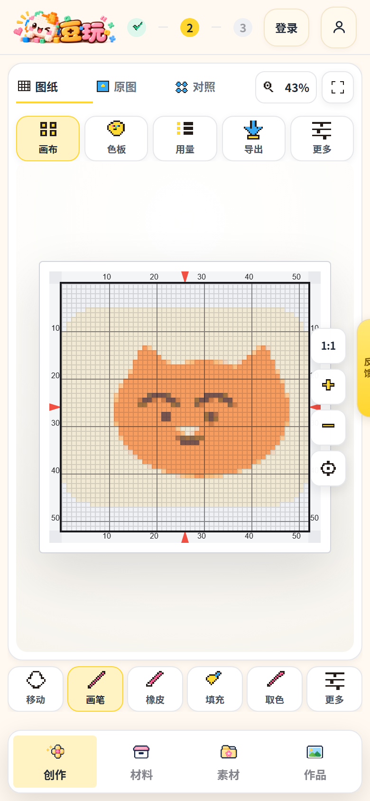
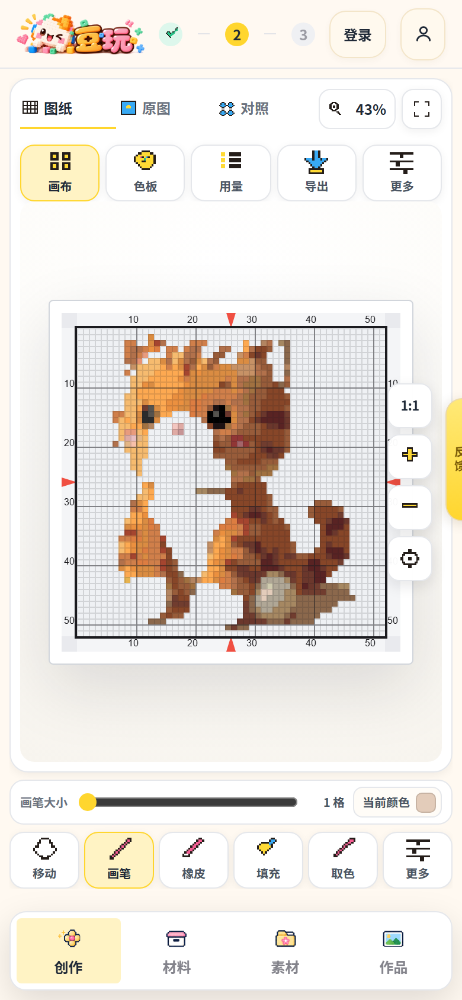

# 手机端 4.0：功能布局改版（2026-10-23）

> 只改手机端工作台的功能布局。桌面 / 平板版面、全局主题、配色、图标、字体、卡片样式、
> 接口与数据结构都没有动。





## 1. 版面结构（≤780px）

```
┌────────────────────────────────────────────┐
│ 图纸 / 原图 / 对照        70%  [适应]       │  ← 页签 + 缩放 + 适应（顶栏）
├────────────────────────────────────────────┤
│ 画布  色板  换图  导出  更多                │  ← 快捷区（画布上方一行）
├────────────────────────────────────────────┤
│                                            │
│                 画  布                      │  ← 尽可能大
│              [撤销][重做][1:1][+][−][定位]  │  ← 六颗轻量浮控
│                                            │
├────────────────────────────────────────────┤
│ 画笔大小 ──●────── 12 格   当前颜色 ■      │  ← 仅画笔 / 橡皮时出现
├────────────────────────────────────────────┤
│ 镜像  画笔  橡皮  填充  取色  更多          │  ← 底部工具行（常驻）
├────────────────────────────────────────────┤
│ 创作      材料      素材      作品          │  ← 底部导航（未改）
└────────────────────────────────────────────┘
```

- 画布顶栏的「适应」把图纸放回窗口；右侧浮控是撤销 / 重做 / 实际大小 / 放大 / 缩小 / 定位。
- 手机端不提供「移动」工具：平移画布用双指拖动，缩放用双指捏合。
- 「移动画布模式 · 单指拖动（或双指）只平移视野，不会修改任何格子」这句只出现在
  手机新手指引第 4 步；电脑端画布下方的提示条不再显示它。
- 顶部「更多」与底部「更多」互斥：打开其中一个会自动收起另一个。
- 两个抽屉都能点空白、点 ×、按 Esc、按手机返回键关闭；返回键只关抽屉，不离开工作台。
- 没有图纸时：导出 / 保存 / 画笔类工具禁用并给出原因，空画布的上传按钮仍可用。

## 2. 老入口 → 新入口 → 事件绑定

### 2.1 功能类（原「功能 ▾」浮层）

| 老入口（3.0） | 新入口（4.0） | 事件绑定 |
| --- | --- | --- |
| 功能 ▾ → 换图 | 快捷区 → 换图 | `openQuick('create')` → `openMobilePanel('create')` |
| 功能 ▾ → 画布 | 快捷区 → 画布 | `openQuick('size')` → `openMobilePanel('size')` |
| 功能 ▾ → 方案 | 快捷区 → 更多 → 方案 | `pickMoreFunction({key:'scheme'})` → `openMobilePanel('scheme')` |
| 功能 ▾ → 色板 | 快捷区 → 色板 | `openQuick('palette')` → `openMobilePanel('palette')` |
| 功能 ▾ → 分析 | 快捷区 → 更多 → 分析 | `pickMoreFunction({key:'analysis'})` → `openMobilePanel('analysis')` |
| 功能 ▾ → 用量 | 快捷区 → 更多 → 用量 | `pickMoreFunction({key:'colors'})` → `openMobilePanel('colors')` |
| 功能 ▾ → 交付 | 快捷区 → 导出 | `openQuick('delivery')` → `openDelivery('export')` |
| 功能 ▾ → 库存 | 快捷区 → 更多 → 库存 | `pickMoreFunction({key:'stock'})` → `openMobilePanel('stock')` |
| 功能 ▾ → 保存作品（`.fnSave`） | 快捷区 → 更多 → 保存作品 | `pickMoreFunction({key:'save'})` → `openSave()` |

### 2.2 编辑类（原「编辑 ▾」浮层）

| 老入口（3.0） | 新入口（4.0） | 事件绑定 |
| --- | --- | --- |
| 编辑 ▾ → 画笔 | 底部工具行 → 画笔 | `pickMobileTool('paint')` → `tool.value = 'paint'`（再点一次开合参数条） |
| 编辑 ▾ → 取色 | 底部工具行 → 取色 | `pickMobileTool('pick')` → `tool.value = 'pick'` |
| 编辑 ▾ → 橡皮 | 底部工具行 → 橡皮 | `pickMobileTool('erase')` → `tool.value = 'erase'`（参数条「橡皮大小」） |
| 编辑 ▾ → 填充 | 底部工具行 → 填充 | `pickMobileTool('fill')` → `tool.value = 'fill'` |
| 编辑 ▾ → 移动 | 手机端不再提供按钮，双指拖动平移 | `stage` 的双指手势（`startTwoFingerPan`） |
| 编辑 ▾ → 撤销 | 画布右侧浮控 → 撤销 | `.stageTools__btn[aria-label="撤销"]` → `undo()` |
| 编辑 ▾ → 重做 | 画布右侧浮控 → 重做 | `.stageTools__btn[aria-label="重做"]` → `redo()` |
| 编辑 ▾ → 左右镜像 | 底部工具行第一格 → 镜像 | `mobileMirror()` → `mirrorPattern('h')`（不切换工具） |
| 编辑 ▾ → 上下镜像 | 手机端已移除 | — |
| 编辑 ▾ → 网格 | 工具行 → 更多 → 网格 开/关 | `toggleGrid()` → `options.showGrid = !options.showGrid` |
| 编辑 ▾ → 分板视图 | 工具行 → 更多 → 分板视图 | `moreView('split')` → `currentView.value = 'split'` |
| 编辑 ▾ → 材料清单 | 工具行 → 更多 → 材料清单 | `moreView('materials')` → `currentView.value = 'materials'` |
| 编辑 ▾ → 新手教程 | 工具行 → 更多 → 新手教程 | `moreTutorial()` → `openTutorial()` |
| 编辑 ▾ → 导出图纸 | 快捷区 → 导出（工具行「更多」里不再重复放） | `openQuick('delivery')` → `openDelivery('export')` |
| 笔刷大小（编辑浮层里的滑杆） | 画笔 / 橡皮时画布下方参数条 | `setBrushSize()` → `brushSize.value`（1–32） |
| 当前颜色（编辑浮层里的色块） | 参数条「当前颜色」 | `openMobilePanel('palette')` |

### 2.3 画布控件（位置变了，功能不变）

| 老入口（3.0） | 新入口（4.0） | 事件绑定 |
| --- | --- | --- |
| 浮控「适应窗口」 | 画布顶栏「适应」 | `fitStage()` |
| 浮控「实际大小」 | 浮控「实际大小」 | `[data-actual-btn-mobile]` → `toggleActualSize()` |
| 浮控「放大」/「缩小」 | 浮控「放大」/「缩小」 | `onUserZoom(zoom ± 0.25)` |
| 浮控「定位到图纸中央」 | 浮控「定位到图纸中央」 | `centerStage()` |
| 页签 图纸 / 原图 / 对照 | 页签 图纸 / 原图 / 对照 | `currentView.value`（未改） |
| 画布标题栏（手机本来就隐藏） | 仍隐藏 | `.canvasTitleBar{display:none}` |

## 3. 自检

| 命令 | 覆盖 |
| --- | --- |
| `node scripts/audit-mobile-layout.cjs` | 320 / 375 / 390 / 430 + 横屏：版面顺序、无横向溢出、两个「更多」互斥、返回键关抽屉 |
| `npm run verify:mobile` | 手机 / 桌面：快捷区、工具行、抽屉内容、空状态、面板、导出 |
| `npm run verify:edit-menu` | 单指落笔 + 撤销还原、双指拖动 / 捏合、浮控撤销重做、工具行镜像、参数条、更多工具 |
| `npm run verify:touch` | 真实触摸事件：单指编辑 / 双指平移 / 捏合缩放（390 与 820） |
| `npm run verify:guide` | 手机新手指引 5 步跟着新入口走 |
| `npm run verify:tutorial` | 手机教程入口改到「更多 → 新手教程」 |
| `npm run verify:palette-ui` | 手机色板入口改到快捷区 |
| `npm run verify` | 全站 84 页 × 4 视口无报错、无横向溢出 |
